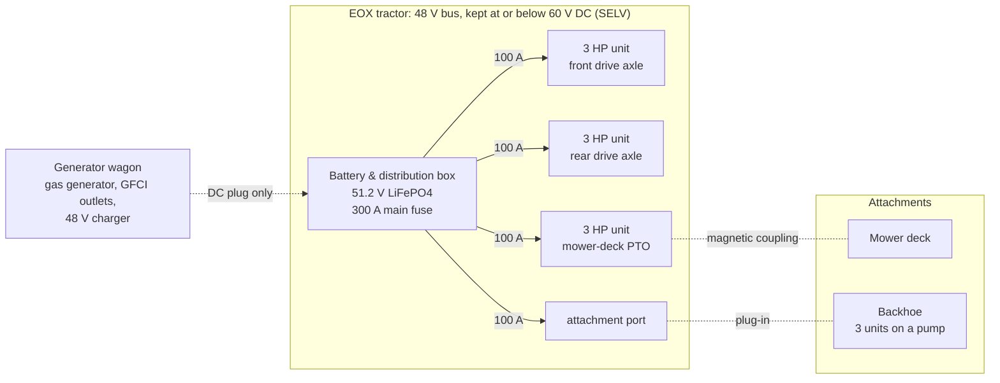
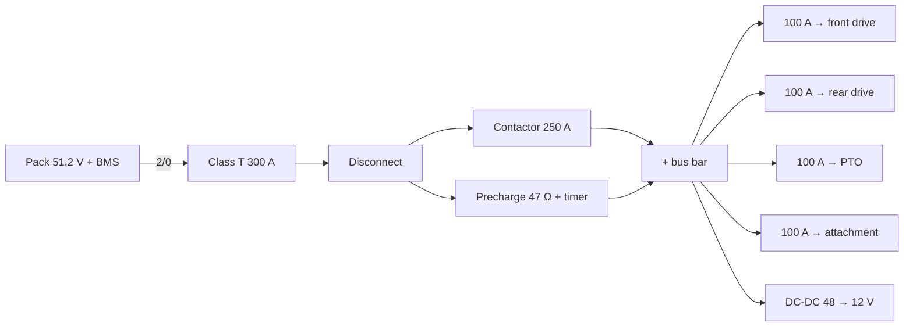
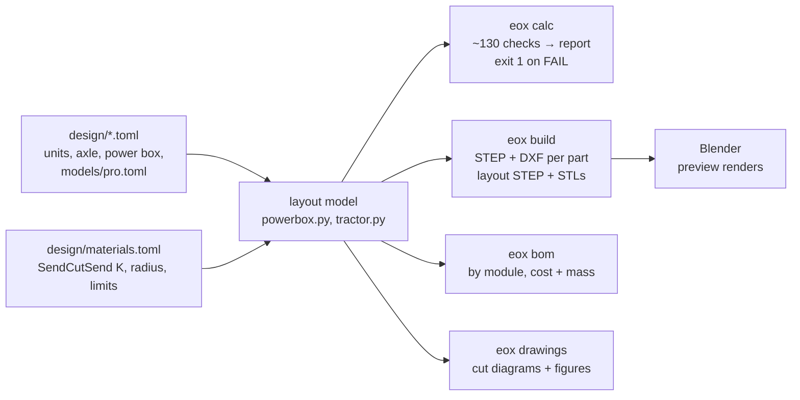

# EOX: open-source electric garden tractor from flat sheet

EOX is a battery-electric garden tractor built from laser-cut and press-brake-bent
sheet metal, plus off-the-shelf **golf-cart** drive parts. The sheet metal is
ordered from SendCutSend, or any shop with the same rules.

The tractor's work is split into standard **3 HP units**: a golf-cart motor plus
its controller on a shared **48 V bus**. Drive axles, the mower PTO and hydraulic
pumps all use the same unit; bigger jobs bundle several. Every panel is a flat
sheet with straight bends, which gives EOX its low-poly look.


| Side | Top | Full lock (35°) |
|---|---|---|
|  |  |  |

*EOX Pro, layout rev P0. The front half (right) carries the battery & distribution
box over its golf-cart axle. The rear half carries the operator. A centre pivot
steers by folding the frame.*

---

## The idea: 3 HP units on a 48 V bus



- **One unit standard:** a 48 V AC golf-cart motor plus controller, ~2.2 kW
  continuous.
  - Plugs in with an Anderson SB120 for power and a Deutsch DT 6-pin for
    enable, interlock and CAN.
  - AC rather than series DC: a series motor over-speeds when its load comes
    off, which is a runaway blade on a thrown belt.
- **Golf-cart ecosystem:** rear ends, motors, controllers, 48 V LiFePO4 packs,
  chargers and 18x8.50-8 wheels are all off the shelf. Golf carts are 48 V;
  the "12 V" is the battery blocks.
- **Two models, shared parts:**

| | EOX Pro | EOX Home |
|---|---|---|
| Layout | Articulated, centre pivot | Steering front axle |
| Drive | AWD: 2 golf-cart drive-axle modules | 2WD: 1 drive-axle module |
| Status | **In design** (`--model pro`) | Planned: [issue 1](https://github.com/zacharyelston/EOx/issues/1) |

Both models share:

- the battery & distribution box;
- the drive-axle module;
- the 3 HP unit standard;
- every attachment.

The full write-up is [docs/architecture.md](docs/architecture.md).

---

## EOX Pro at a glance

| | |
|---|---|
| Machine mass | 299 kg without operator. Axle split 41 / 59 with operator. |
| Drive | 2 × golf-cart rear end (~12.4:1) + 3 HP AC unit each, AWD, 8 km/h limit |
| Steering | Hydraulic cylinder at the pivot. 1,160 N·m available vs ~900 N·m needed at standstill. 2.8 s lock to lock. |
| Turning radius | 2.6 m, outer tyre |
| Pack | 51.2 V 100 Ah LiFePO4 (5.1 kWh), BMS ≥ 200 A continuous |
| Purchased parts | ≈ $6,500 budgetary, plus SendCutSend quotes |
| Checks | `eox calc --model pro`: **0 FAIL, 7 WARN** |

### Stability

The pivot lets the two halves roll ±10° relative to each other, so each half
first rests on its own **stability triangle**: its two wheels plus the pivot.
Past the roll stop, the whole machine rests on all four wheels.

<picture>
  <source media="(prefers-color-scheme: dark)" srcset="docs/img/pro-stability-dark.svg">
  
</picture>

- The lowest tip angle is **37°**, on the rear half's triangle.
- Half of that gives an **18.7° max working slope**, which is industry practice
  rather than a confirmed standard value.
- The design slope is 15°.
- For workplace use, label the machine for **17° across a slope** (MIOSHA
  5443).

---

## Battery & distribution box

| Exploded | Closed |
|---|---|
|  |  |

The box is a **sealed clamshell**: a shallow tray plus a cover that overlaps it
by 30 mm.

- **Why two shells:** SendCutSend can't bend one box deep enough. Flat blanks
  max out at 30 × 44 in, and a U-channel's base must be ≥ 2× its flange.
- **Inside:** the pack (blue), held by two clamp bars and two stop angles; the
  distribution bay (orange) with the main fuse, contactor, precharge,
  disconnect, 4 branch fuses and the DC-DC.
- **Outside:** one M32 gland per unit branch on the end wall.



**Thermal:**

- A full 1.4 h mowing run in 35 °C sun takes the pack from 43 °C (already
  heat-soaked) to **48 °C**, against its 60 °C rating.
- The pack's 45 kg of cells give it a ~3.9 h thermal time constant, so a run
  never reaches steady state.

Details are in [docs/powerbox.md](docs/powerbox.md).

---

## Sheet-metal cut diagrams

These are generated from the same geometry that SendCutSend receives, so they
can't drift from the parts. All parts are 5052-H32 aluminium, 0.125 in. Flats
use SendCutSend's own bend deduction (K 0.44, inside radius 0.125 in).

- **Solid lines:** cut.
- **Dashed blue lines:** bend; every flange folds up 90° toward you.

**Order** the `out/cad/powerbox/PB-xxx.step` files; the DXFs and these diagrams
are the reference.

<picture>
  <source media="(prefers-color-scheme: dark)" srcset="docs/img/flats/PB-101-dark.svg">
  
</picture>

<picture>
  <source media="(prefers-color-scheme: dark)" srcset="docs/img/flats/PB-102-dark.svg">
  
</picture>

| Battery clamp bar | Battery stop angle |
|---|---|
| <picture><source media="(prefers-color-scheme: dark)" srcset="docs/img/flats/PB-104-dark.svg"></picture> | <picture><source media="(prefers-color-scheme: dark)" srcset="docs/img/flats/PB-105-dark.svg"></picture> |

| Part | Flat (mm) | Bends | Qty | Mass each |
|---|---|---|---|---|
| PB-101 Tray | 1,045 × 625 (94 % of the 44 × 30 in bend limit) | 4 | 1 | 4.8 kg |
| PB-102 Cover | 1,050 × 630 | 4 | 1 | 4.9 kg |
| PB-104 Battery clamp bar | 326 × 79 | 2 | 2 | 0.22 kg |
| PB-105 Battery stop angle | 250 × 59 | 1 | 2 | 0.13 kg |

The axle subframes, the pivot and the deck aren't designed yet
([issue 4](https://github.com/zacharyelston/EOx/issues/4),
[issue 5](https://github.com/zacharyelston/EOx/issues/5),
[issue 7](https://github.com/zacharyelston/EOx/issues/7)). Their cut diagrams
will appear here as they are.

---

## Power and runtime

<picture>
  <source media="(prefers-color-scheme: dark)" srcset="docs/img/pro-modes-dark.svg">
  
</picture>

| Mode | Units running | Battery power | Runtime, one pack | Target |
|---|---|---|---|---|
| Mowing (5 km/h, flat) | 2 drive + PTO | 2.9 kW | 1.4 h | 1.5 h: WARN |
| Mowing a 10° slope (3 km/h) | 2 drive + PTO | 3.5 kW | 1.2 h | 1.0 h |
| Transport (8 km/h) | 2 drive | 1.6 kW | 2.6 h | 3.0 h: WARN |
| Backhoe | 3 hydraulic | 5.1 kW | 0.8 h | 1.0 h: WARN |

One 100 Ah pack is short for a working Pro. The options are a larger or second
pack, swappable packs, or the generator wagon
([issue 3](https://github.com/zacharyelston/EOx/issues/3),
[issue 9](https://github.com/zacharyelston/EOx/issues/9)).

---

## How the design works

Each model's numbers live in a few TOML files. Change one, re-run, and the
geometry, cut diagrams, engineering checks and BOM all update together.



| Shared design files | Per model |
|---|---|
| `design/units.toml`: 3 HP unit, 48 V bus, operating modes | `design/models/pro.toml`: articulated layout, steering, module counts |
| `design/axle.toml`: golf-cart drive-axle module | `design/models/home.toml`: planned |
| `design/powerbox.toml`: battery & distribution box | |
| `design/materials.toml`: SendCutSend bend data | |

## Quick start

You need [uv](https://docs.astral.sh/uv/). Blender is optional and only renders
the previews.

```bash
uv run eox calc --model pro
```

```bash
uv run eox build --model pro
```

```bash
uv run eox bom --model pro
```

```bash
uv run eox drawings --model pro
```

```bash
/Applications/Blender.app/Contents/MacOS/Blender -b -P tools/render_preview.py -- out/cad/pro/stl docs/img/pro-side.png --view side
```

- `calc` writes `out/pro-report.md`.
- `build` writes the STEP files to order, the flat DXFs, and the layout scenes.
- `bom` writes `out/pro-bom.csv`.
- `drawings` regenerates the SVG figures in `docs/img/`.
- The Blender command renders one view; `tools/render_preview.py` lists the
  rest.

`uv run eox all` runs everything, and `uv run pytest` runs the tests.

## Repository

| Path | What |
|---|---|
| `design/` | Parameters, the source of truth: shared files + `models/` |
| `src/eox/sheetmetal.py` | Bent-panel primitive: 3D solid, flat pattern, SCS rule checks |
| `src/eox/powerbox.py`, `tractor.py` | Box and whole-machine layouts |
| `src/eox/calcs/` | Engineering checks: `bus`, `drive`, `vehicle`, `powerbox` |
| `src/eox/drawings.py` | Cut diagrams and figures (SVG, light + dark) |
| `bom/purchased.csv` | Purchased parts by module; each model sets its module counts |
| `docs/` | [Architecture](docs/architecture.md), [power box](docs/powerbox.md), [safety requirements](docs/safety-requirements.md), [tooling decision](docs/tooling.md), [component candidates](docs/component-candidates.md) |
| `tools/` | Blender preview renderer |

## Status and open work

**EOX Pro P0, power box B0: 0 FAIL, 7 WARN.**

- **Runtime:** short on one 100 Ah pack. See
  [issue 3](https://github.com/zacharyelston/EOx/issues/3).
- **Gearing:** stock rear ends need 1.8× rated torque on a sustained 10° climb;
  a ~2:1 stage brings it to 0.9×. See
  [issue 2](https://github.com/zacharyelston/EOx/issues/2).
- **Bus current:** 185 A with 3 units running, against the pack's 200 A rating.
- **Thin margins:**
  - BMS over-voltage trip: 59.2 V of 60;
  - charging in the sun: 43.9 °C of 45.

All open work is in the
[GitHub issues](https://github.com/zacharyelston/EOx/issues):

- the Home model;
- the subframe, pivot and hydraulic steering;
- the deck and its magnetic coupling;
- the unit interface standard;
- the generator wagon and backhoe;
- B71.1 verification;
- prototype tests;
- the licence;
- low-poly body panels.

## Safety

This is open hardware for builders, not a certified product. Read
[docs/safety-requirements.md](docs/safety-requirements.md) before building.

- The pack must be listed to UL 2271 or IEC 62619.
- Do not build packs from loose cells.

## License

MIT; see [LICENSE](LICENSE). A hardware-specific licence for the design files
is open: see [issue 13](https://github.com/zacharyelston/EOx/issues/13).
