# EOX: open-source electric garden tractor from flat sheet

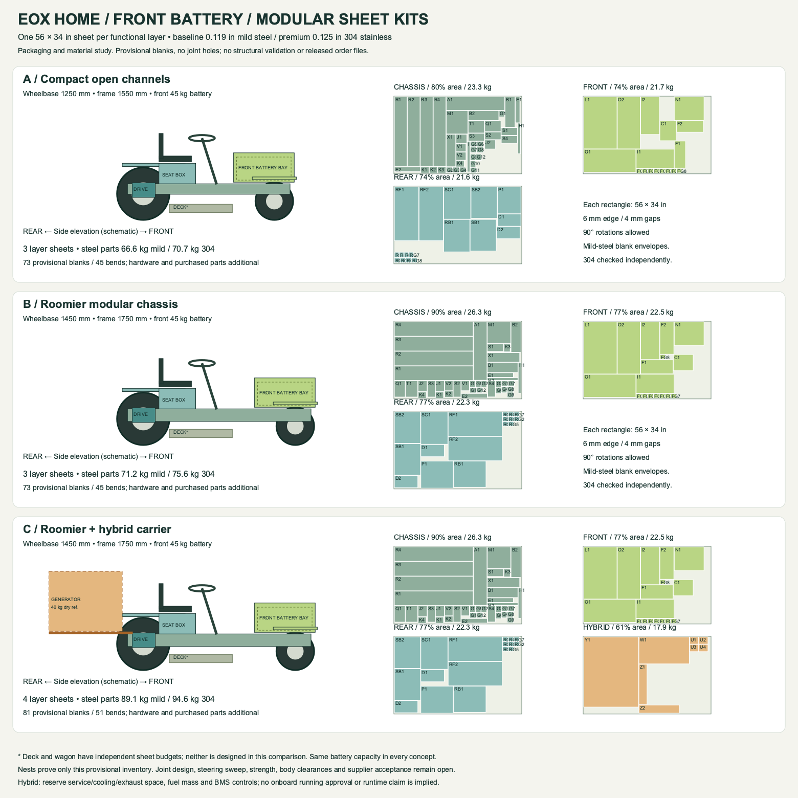

*Concept layouts and provisional layer nests; structural and assembly validation are still in progress.*

EOX is a battery-electric garden tractor built from laser-cut and press-brake-bent
sheet metal, with off-the-shelf motors, controllers and electrical power
components. The steel chassis and axle structures are EOX parts that a
homeowner can order cut/bent and assemble with standard hardware.

**Current direction (2026-10-22):** develop Home as a simple, appealing
open-source steel kit with one 56 × 34 in reference sheet per functional layer:
chassis, front bodywork, rear bodywork/seat box, plus separate attachments.
Publish reproducible SendCutSend order files, assembly instructions and
complete costs so homeowners can build it and contributors can iterate on it.
The battery bay is at the front and electric drive at the rear. Compare mild
steel with premium 0.125 in 304 stainless. See the [product brief](docs/product-brief.md)
and [new concept layouts and layer nests](docs/home-concepts.md).
Golf-cart sourcing is for power components and controllers, not donor frames,
axles or steering assemblies. See the [steel chassis study](docs/steel-chassis.md).
The H0/P0 layouts, costs and simulation results below describe the earlier
donor-based reference models; they are not results for the redesigned kit.

The tractor's work is split into standard **3 HP units**: a golf-cart motor plus
its controller on a shared **48 V bus**. Drive axles, the mower PTO and hydraulic
pumps all use the same unit; bigger jobs bundle several. Every panel is a flat
sheet with straight bends, which gives EOX its low-poly look.

| EOX Home: steering front axle, 2WD | EOX Pro: articulated, AWD |
|---|---|
| 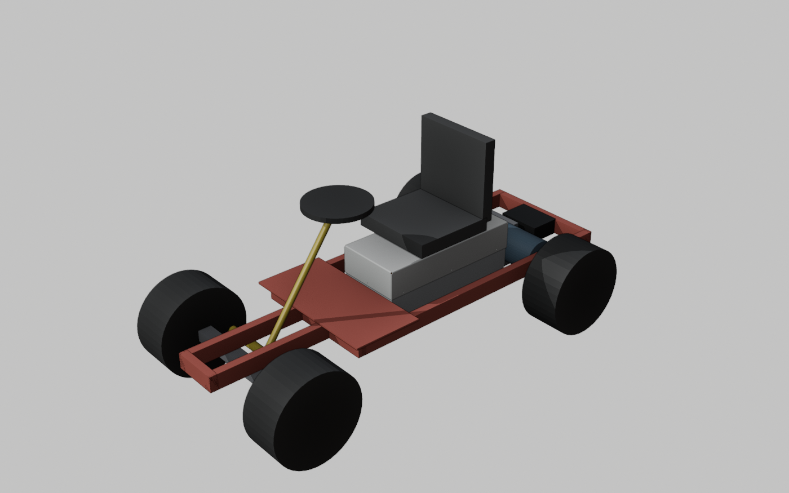 | 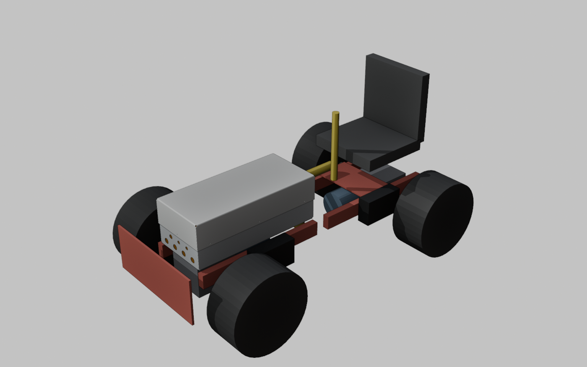 |

*Layout revs H0 and P0, drawn to real golf-cart geometry
([docs/research/golf-cart.md](docs/research/golf-cart.md)). Both models use
the same battery & distribution box, the same golf-cart drive-axle module and
the same 3 HP unit.*

| EOX Home on the terrain course | EOX Pro on the terrain course |
|---|---|
| 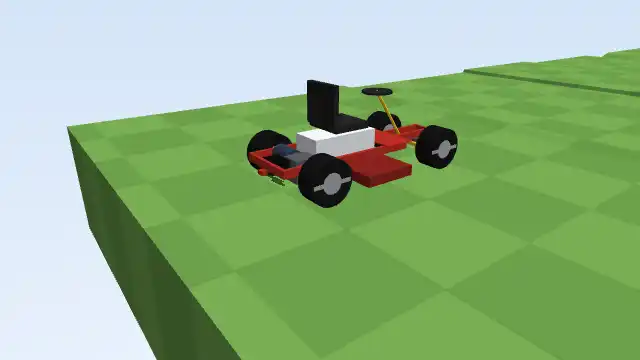 | 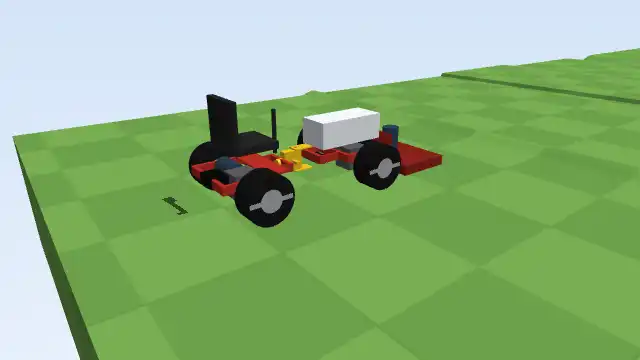 |

*MuJoCo simulation, deck fitted, at 6× speed. The machines and their masses
are the same objects the calcs use. Videos at 3× speed:
[Home](docs/video/home-course.mp4), [Pro](docs/video/pro-course.mp4). Results
are under [Terrain course](#terrain-course).*

---

## The idea: 3 HP units on a 48 V bus

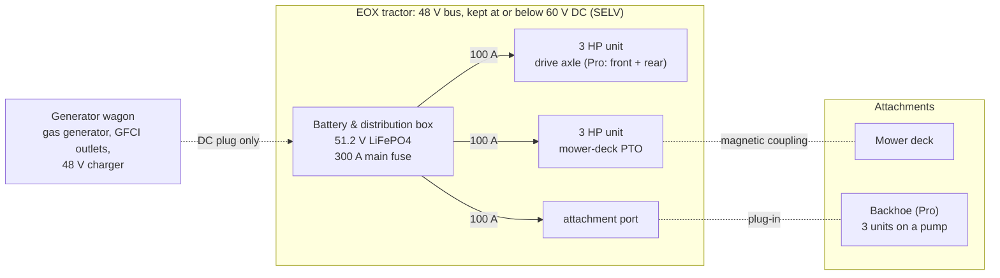

- **One unit standard:** the golf cart's own 48 V DC sepex motor plus
  controller, used or rebuilt, ~3 hp continuous.
  - Simple and serviceable: any golf-cart shop can rebuild one.
  - Speed control and regen braking.
  - Plugs in with an Anderson SB120 for power and a Deutsch DT 6-pin for
    enable, interlock and CAN.
  - AC golf-cart units are an optional upgrade.
  - Plain series-wound DC is never used on a blade: it over-speeds when its
    load comes off.
- **Golf-cart ecosystem:** rear ends, front axles, motors, controllers, 48 V
  LiFePO4 packs, chargers and 18x8.50-8 wheels are all off the shelf. Golf
  carts are 48 V; the "12 V" is the battery blocks.
- **Two models, shared parts:**

| | EOX Home | EOX Pro |
|---|---|---|
| Layout | Golf-cart front steering axle, rack and pinion | Articulated: two halves on a centre pivot |
| Drive | 2WD: 1 drive-axle module | AWD: 2 drive-axle modules |
| Units at once | 2 (drive + PTO) | 3 (2 drive + PTO, or 3 hydraulic) |
| Machine mass (bare / deck fitted) | 237 / 302 kg | 305 / 371 kg |
| Rated climb, deck fitted | 12° (15:1 gear set) | 15° (stock gearing) |
| Purchased parts | ≈ $3,700 | ≈ $5,300 |
| Status | In design: `--model home`, H0 | In design: `--model pro`, P0 |

Both models share:

- the battery & distribution box (the same part, with 4 unit branches);
- the drive-axle module;
- the 3 HP unit standard;
- the attachments.

The full write-up is [docs/architecture.md](docs/architecture.md).

---

## EOX Home at a glance

| Side | Top |
|---|---|
| 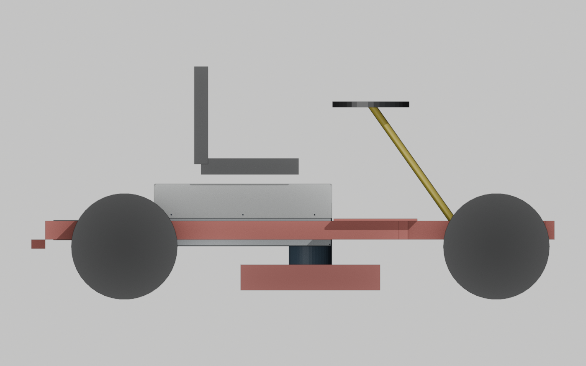 | 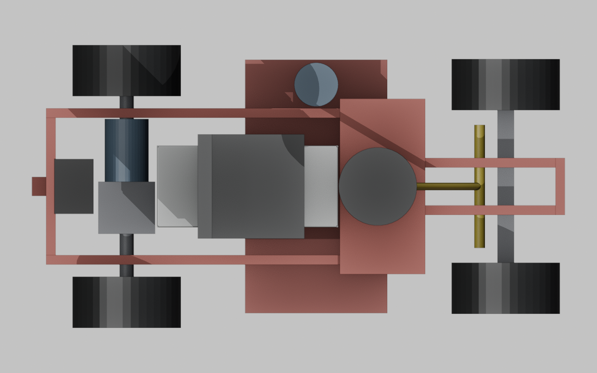 |

A golf cart turned into a tractor:

- **Rear:** the drive-axle module. The motor sits sideways on the off-centre
  gear case, as on a real cart.
- **Between the axles:** the battery & distribution box, slung low, with the
  seat on top at about 0.6 m.
- **Front:** a TXT-style beam front axle with its rack bolted on. The frame
  necks in at the nose to clear the steered wheels.
- **Under the box:** the mid-mount mower deck, with its PTO unit standing on it
  outboard of the left rail.

| | |
|---|---|
| Machine mass | 237 kg without operator, 302 kg with the deck and its PTO unit. Axle split 33 / 67 with operator, 36 / 64 with the deck. |
| Drive | 1 × golf-cart rear end with a 15:1 gear set + 3 HP DC sepex unit, rear-drive, 8 km/h limit |
| Rated climb | 12° short climbs with the deck fitted |
| Steering | Manual rack and pinion, ~90 N at the rim to steer at a standstill (estimate) |
| Turning radius | 2.8 m, outer front tyre (golf-cart wheelbase 1.6 m) |
| Runtime, one pack | 1.45 h mowing (target 1.5), 3.5 h transport |
| Deck | The front axle has no diff, so it clears a mid-mount deck by +50 mm (REF) and the tractor can drive over it |
| Checks | `eox calc --model home`: **0 FAIL, 4 WARN** |

**Rated for 12° climbs, on a 15:1 gear set**
([issue 2](https://github.com/zacharyelston/EOx/issues/2); [design review](docs/reviews/initial-design-review.md)).

- Mowing a slope is the design case, so the climb checks carry the 45 kg deck
  and its PTO unit.
- With one driven axle, the motor runs above its rated torque on climbs.
  Golf-cart DC motors peak at about 4× rated (Carryall 3.3 hp rated, 13 hp
  peak), and long climbs heat them.
- **Grip sets the rating.** With the deck's weight between the axles, the rear
  tyres grip up to about **14°** on turf (traction about 0.5 at 12 psi), whatever the gearing.
  Home is rated for 12° short climbs, inside that limit; the Pro (AWD) keeps
  15°.
- **The 15:1 gear set is standard** (BOM G01, in the stock rear end). On the
  stock 12.4:1 set a 12° climb needs 3.8× rated, close to the ~4× peak; on
  15:1 it needs 3.2×.

| Rear end | 10° climb | 12° short climb | Top speed at base rpm |
|---|---|---|---|
| Stock golf-cart, 12.4:1 | 3.4× rated | 3.8× (near the peak) | 25 km/h |
| **Stock + aftermarket 15:1 gear set** (Home standard) | 2.8× (WARN) | 3.2× | 21 km/h, limited to 8 |
| Stock + 2:1 chain stage | 1.7× | 2.0× | 13 km/h |

<picture>
  <source media="(prefers-color-scheme: dark)" srcset="docs/img/home-stability-dark.svg">
  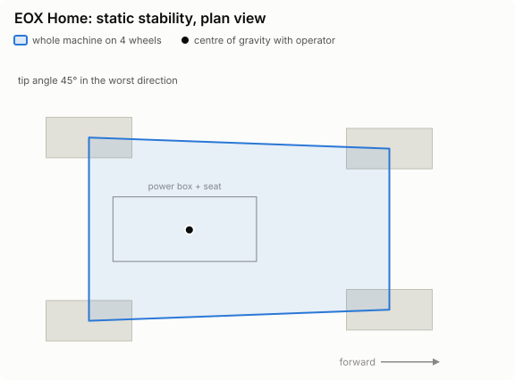
</picture>

The figure shows the mowing configuration. The static tip angle, the worse of
bare and deck-fitted, is 45° in the worst direction, which gives a **22.7° max
working slope**.

---

## EOX Pro at a glance

| Side | Top | Full lock (40°) |
|---|---|---|
| 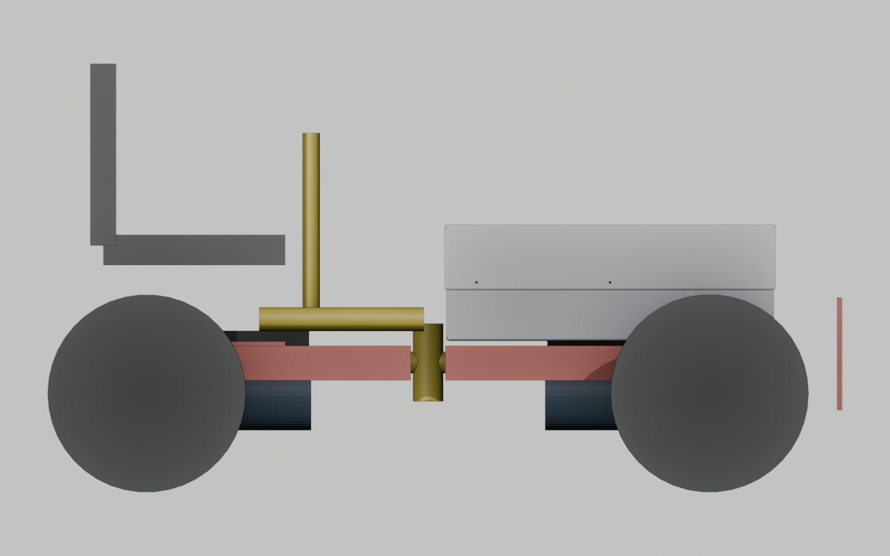 | 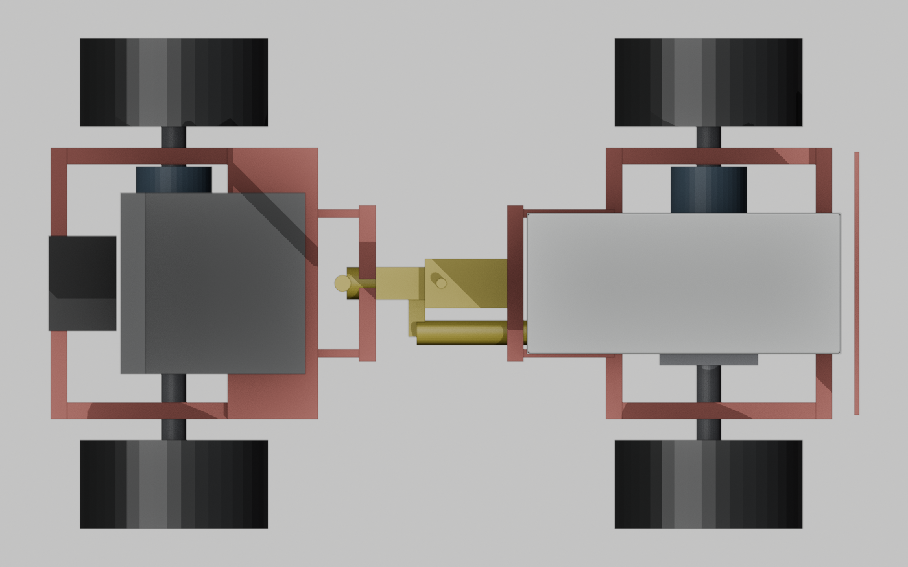 | 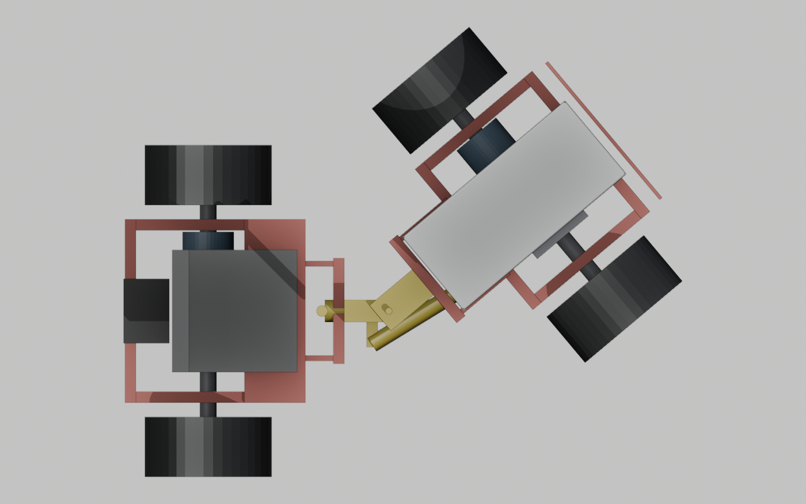 |

The front half carries the battery & distribution box over its golf-cart axle,
and the rear half carries the operator.

- **Frames:** each half's frame necks in to a ±160 mm hinge zone.
- **Joint:** front clevis ears carry upper and lower 25 mm pins into a knuckle,
  which rides on a fore-aft roll trunnion into the rear half. This is the
  layout small articulated loaders use; see
  [docs/research/articulation.md](docs/research/articulation.md).
- **Steering:** one hydraulic cylinder runs from the front frame to the
  knuckle, so the rolling halves can't steer the machine.

| | |
|---|---|
| Machine mass | 305 kg without operator, 371 kg with the front-mount deck and its PTO unit. Axle split 43 / 57 with operator, 58 / 42 with the deck. |
| Drive | 2 × stock golf-cart rear end + 3 HP DC sepex unit each, AWD, 8 km/h limit |
| Steering | Hydraulic: 1,173 N·m available vs ~1,050 N·m needed at standstill with the deck fitted (WARN, 12 % margin), 3.3 s lock to lock, ±40° |
| Pivot | Halves clear each other at ±40° (checked); the front half stays 231 mm from the footwell; 5 kN per pin at 3 g |
| Turning radius | 2.4 m, outer tyre |
| Checks | `eox calc --model pro`: **0 FAIL, 8 WARN** |

### Stability

The pivot lets the two halves roll ±10° relative to each other, so each half
first rests on its own **stability triangle**: its two wheels plus the pivot.
Past the roll stop, the whole machine rests on all four wheels.

<picture>
  <source media="(prefers-color-scheme: dark)" srcset="docs/img/pro-stability-dark.svg">
  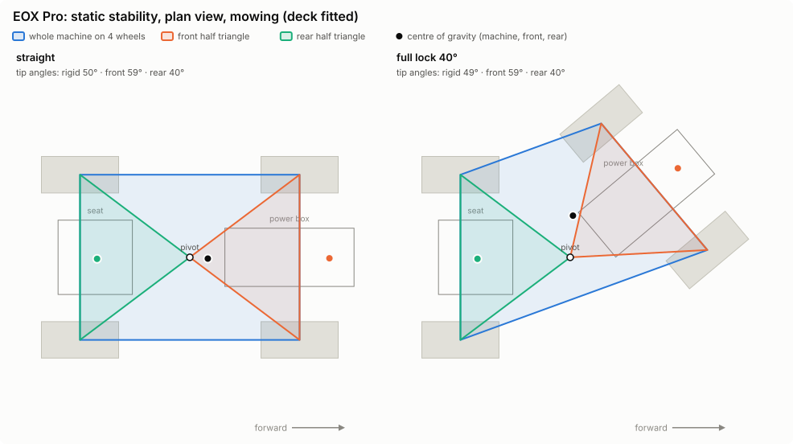
</picture>

- The figure shows the mowing configuration (deck fitted). The checks take the
  worse of bare and deck-fitted.
- The lowest tip angle is **40°**, on the rear half's triangle.
- Half of that gives a **20.2° max working slope**, which is industry practice
  rather than a confirmed standard value.
- For workplace use, label both models for **17° across a slope** (MIOSHA
  5443).

---

## Battery & distribution box

| Exploded | Closed |
|---|---|
|  | 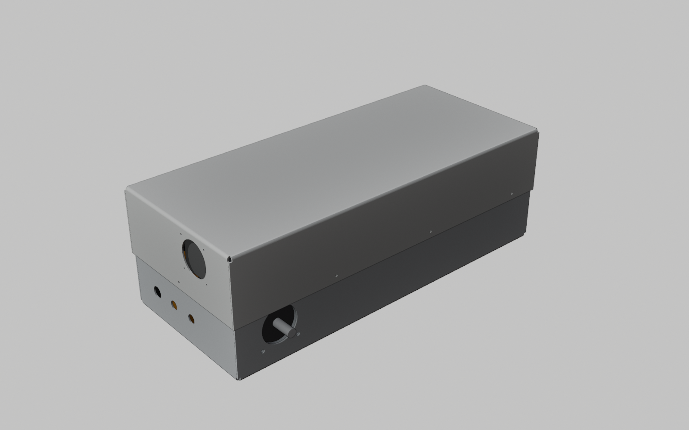 |

The box is a **sealed clamshell**: a shallow tray plus a cover that overlaps it
by 30 mm.

- **Why two shells:** SendCutSend can't bend one box deep enough. Flat blanks
  max out at 30 × 44 in, and a U-channel's base must be ≥ 2× its flange.
- **Inside:** the pack (blue), held by two clamp bars and two stop angles; the
  distribution bay (orange) with the main fuse, contactor, precharge,
  disconnect, 4 branch fuses and the DC-DC.
- **Outside:** one M32 gland per unit branch on the end wall.

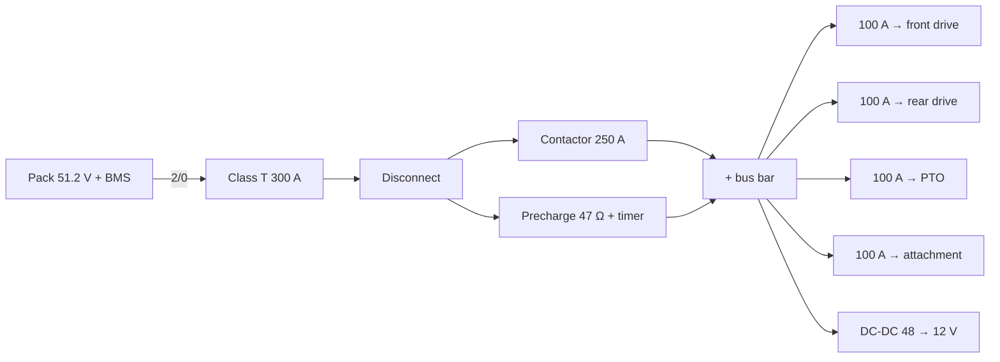

**Thermal:**

- A full 1.3 h Pro mowing run in 35 °C sun takes the pack from 43 °C (already
  heat-soaked) to **49 °C**, against its 60 °C rating.
- The pack's 45 kg of cells give it a ~3.9 h thermal time constant, so a run
  never reaches steady state.

Details are in [docs/powerbox.md](docs/powerbox.md).

---

## Sheet-metal cut diagrams

These are generated from the same geometry that SendCutSend receives, so they
can't drift from the parts. All parts are 5052-H32 aluminium, 0.125 in. Flats
use SendCutSend's own bend deduction (K 0.44, inside radius 0.125 in).

- **Solid lines:** cut.
- **Dashed blue lines:** bend; every flange folds up 90° toward you.

**Order** the `out/cad/powerbox/PB-xxx.step` files; the DXFs and these diagrams
are the reference.

<picture>
  <source media="(prefers-color-scheme: dark)" srcset="docs/img/flats/PB-101-dark.svg">
  
</picture>

<picture>
  <source media="(prefers-color-scheme: dark)" srcset="docs/img/flats/PB-102-dark.svg">
  
</picture>

| Battery clamp bar | Battery stop angle |
|---|---|
| <picture><source media="(prefers-color-scheme: dark)" srcset="docs/img/flats/PB-104-dark.svg"></picture> | <picture><source media="(prefers-color-scheme: dark)" srcset="docs/img/flats/PB-105-dark.svg"></picture> |

| Part | Flat (mm) | Bends | Qty | Mass each |
|---|---|---|---|---|
| PB-101 Tray | 1,045 × 625 (94 % of the 44 × 30 in bend limit) | 4 | 1 | 4.8 kg |
| PB-102 Cover | 1,050 × 630 | 4 | 1 | 4.9 kg |
| PB-104 Battery clamp bar | 326 × 79 | 2 | 2 | 0.22 kg |
| PB-105 Battery stop angle | 250 × 59 | 1 | 2 | 0.13 kg |

The axle subframes, the pivot and the deck aren't designed yet
([issue 4](https://github.com/zacharyelston/EOx/issues/4),
[issue 5](https://github.com/zacharyelston/EOx/issues/5),
[issue 7](https://github.com/zacharyelston/EOx/issues/7)). Their cut diagrams
will appear here as they are.

---

## Power and runtime

Both models run on one 51.2 V 100 Ah pack (4.1 kWh usable).

<picture>
  <source media="(prefers-color-scheme: dark)" srcset="docs/img/home-modes-dark.svg">
  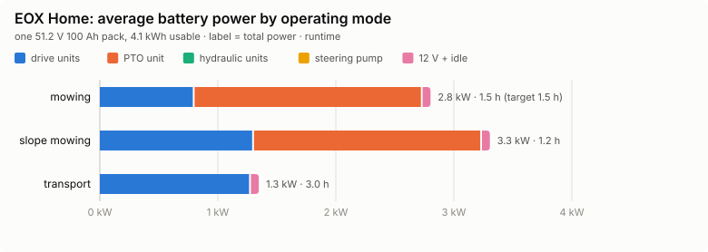
</picture>

<picture>
  <source media="(prefers-color-scheme: dark)" srcset="docs/img/pro-modes-dark.svg">
  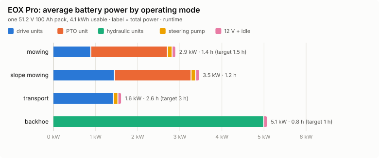
</picture>

| Mode | Home: power / runtime | Pro: power / runtime | Target |
|---|---|---|---|
| Mowing (5 km/h, flat) | 2.8 kW / 1.45 h (WARN) | 3.1 kW / 1.32 h (WARN) | 1.5 h |
| Mowing a 10° slope (3 km/h) | 3.5 kW / 1.18 h | 3.9 kW / 1.06 h | 1.0 h |
| Transport (8 km/h) | 1.2 kW / 3.54 h | 1.5 kW / 2.65 h (WARN) | 3.0 h |
| Backhoe (3 hydraulic units) | n/a | 5.4 kW / 0.8 h (WARN) | 1.0 h |

- **Home:** is within a few minutes of every target on one pack.
- **Pro:** two drive units, a steering pump and the backhoe need more. The
  options are a larger or second pack, swappable packs, or the generator wagon
  ([issue 3](https://github.com/zacharyelston/EOx/issues/3),
  [issue 9](https://github.com/zacharyelston/EOx/issues/9)).

---

## Terrain course

Both models drive a standard test course in a [MuJoCo](https://mujoco.org)
rigid-body simulation, bare and with the deck fitted. The simulated machine is
generated from the same masses and part envelopes the calcs use. Parked, its
axle loads match the hand calc within 2 %. Details:
[docs/simulation.md](docs/simulation.md).

The course has seven obstacles: a bump, a kerb, a ditch, a twist, 12° and 15°
climbs, and a 17° side slope.

<picture>
  <source media="(prefers-color-scheme: dark)" srcset="docs/img/home-course-dark.svg">
  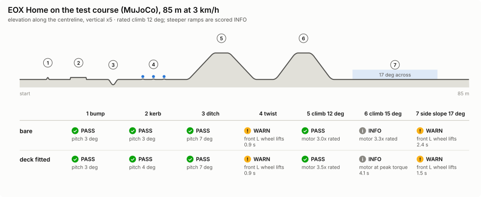
</picture>

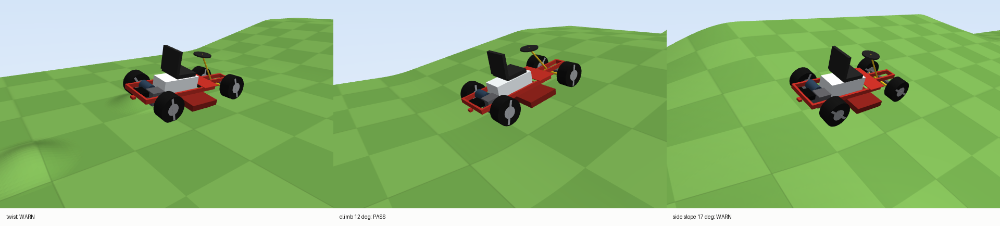

*EOX Home, deck fitted: the twist, its rated 12° climb and the 17° side slope.
[Watch the run](docs/video/home-course.mp4) (MP4, 36 s at 3× speed).*

<picture>
  <source media="(prefers-color-scheme: dark)" srcset="docs/img/pro-course-dark.svg">
  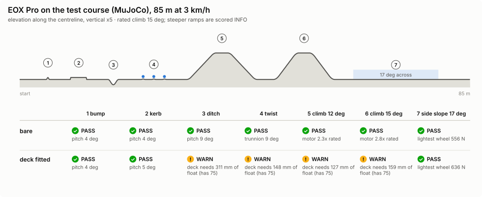
</picture>

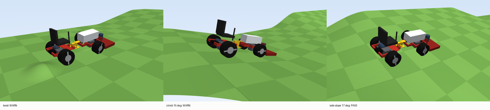

*EOX Pro, deck fitted: the twist on its trunnion, its rated 15° climb and the
17° side slope. [Watch the run](docs/video/pro-course.mp4) (MP4, 33 s at 3×
speed).*

What the course found that the static checks can't:

- **Home's leaf-sprung front axle runs out of roll travel.** On the twist, and
  where the side slope tilts in and out, a front wheel lifts for 1–2.5 s. On
  the steady 17° slope all four wheels stay loaded. A pivoting front axle
  would fix it.
- **Home's 12° rating has little margin.** With the deck, it climbs 12° at
  3.5× rated motor torque and starts spinning out near 13°. That is a degree
  below the calc's 14.2° grip limit: the open diff lets the lighter rear wheel
  set the limit.
- **Pro clears everything bare.** The trunnion takes the twist (9° of its
  ±10°), and the 17° side slope leaves about 550 N on the lightest wheel.
- **The Pro's front deck has to pivot.** Mounted rigidly, it would dig
  130–310 mm into the climbs, the twist and the ditch.

---

## Design trials

A trial asks one design question and evolves an answer. It declares which
design values may change, what to push up or down, and what must stay true.
A seeded genetic algorithm then breeds designs, and every candidate runs the
full engineering checks and the terrain course. See
[docs/trials.md](docs/trials.md).

```bash
uv run eox evolve --trial home-front-battery
```

**The first trial asks:** can the Home carry its battery at the front, like a
tractor's engine? ([report](trials/home-front-battery/report.md))

**Answer:** it can, but today's layout scores better (−28.6 against −26.3).

- **The layout:** the box goes high over the front axle, clear of the steered
  tyres. The operator moves back over the rear axle, and the deck moves back.
- **Gains:** grip goes up only from 14.2° to 14.5°.
- **Costs:** working slope goes down from 22.7° to 20.6°, and the machine
  gains 11 kg.
- **Why:** the gain comes from moving the operator onto the driven wheels,
  not from moving the battery.

<picture>
  <source media="(prefers-color-scheme: dark)" srcset="trials/home-front-battery/progress-dark.svg">
  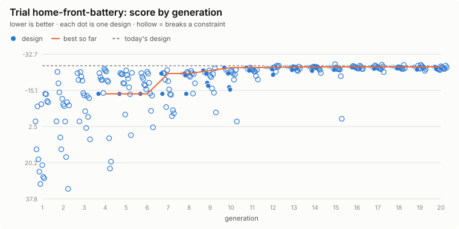
</picture>

---

## Baselines: real machines

Four real machines are modelled from their published specs (`design/reference/`)
and run through the same checks and the same course: the John Deere X350, Cub
Cadet XT1 LT42 and Ryobi 80V 42″ lawn tractors, and the Husqvarna R 316TX AWD
articulated rider. What makers don't publish (weight split, CG height) is
estimated and marked REF. Full table: [docs/baselines.md](docs/baselines.md).

```bash
uv run eox baseline
```

<picture>
  <source media="(prefers-color-scheme: dark)" srcset="docs/img/baselines-dark.svg">
  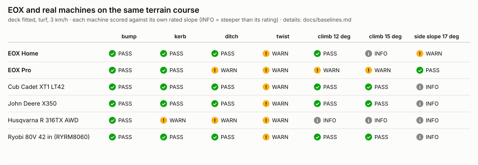
</picture>

- **The real lawn tractors don't lift a wheel on the twist or the side slope.**
  Their front axles pivot. Home's leaf-sprung axle lifts a wheel on both. That
  is the clearest case yet for a pivoting front axle on the Home.
- **Home is more stable but grips less.** Its working slope is 24° against the
  lawn tractors' 13–14°: the battery sits low and all four wheels carry it.
  But they climb on grip to about 16° against Home's 14°, partly because
  their higher CG puts more load on the driven wheels on a climb, the same
  height that costs them stability.
- **Pro and the Husqvarna grip the same with AWD (22°).** The Pro is rated
  15° against the Husqvarna's 10°, and its working slope is 20° against 14°.
  Both front decks would dig in on the ditch if mounted rigidly: Pro 307 mm,
  Husqvarna 357 mm. So both need a pivoting deck, which is how the
  Husqvarna's actually works.
- **Weight, runtime and price:**
  - EOX is heavier: Home 302 kg against 236–253 kg, and Pro 371 kg against
    287 kg.
  - EOX runs longer on a charge: 1.3–1.4 h against the Ryobi's 1.0–1.25 h.
  - EOX parts cost about $3.7k (Home) and $5.3k (Pro). The rivals retail at
    $2.4k–5k, and about $10k for the Husqvarna (EU price, without its deck).

---

## Tyre pressure and ground

Tyre grip and rolling resistance come from each tyre's size, pressure and
load, and the ground's strength (Brixius / ASAE D497). In the sim, each tyre
squashes like a spring at its pressure. Details:
[docs/simulation.md](docs/simulation.md#tyres-and-ground).

```bash
uv run eox tyres --model home
```

<picture>
  <source media="(prefers-color-scheme: dark)" srcset="docs/img/home-tyres-dark.svg">
  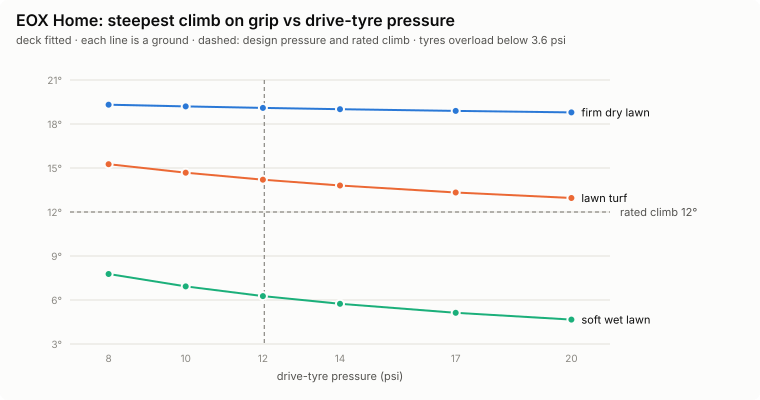
</picture>

- **Softer tyres grip more, and the softer the ground, the more it matters.**
  On typical lawn, Home's climb limit goes from 14.2° at its 12 psi design
  pressure to 15.3° at 8 psi. On firm lawn pressure barely matters.
- **The ground matters far more than pressure.** On soft wet ground the
  rear-drive Home can only climb 6–8°, half its 12° rating. The AWD Pro
  holds 12–16°.
- **Read these as comparisons, not absolutes.** The traction equations are
  empirical, and a pull test at two pressures would calibrate them.

---

## How the design works

Each model's numbers live in a few TOML files. Change one, re-run, and the
geometry, cut diagrams, engineering checks and BOM all update together.

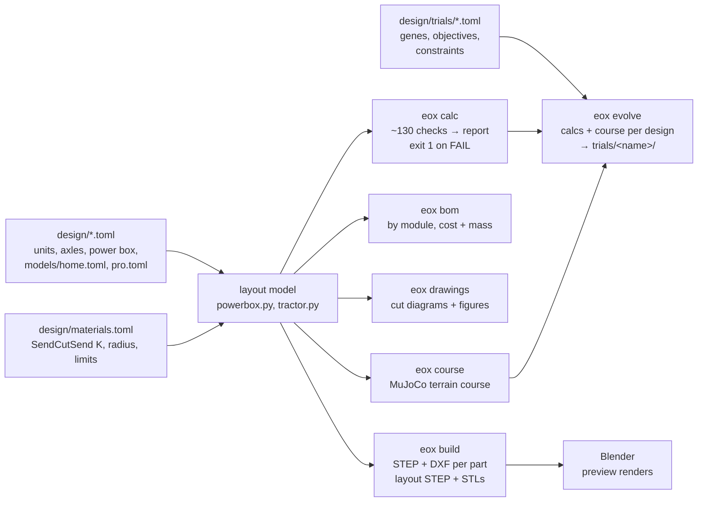

| Shared design files | Per model |
|---|---|
| `design/units.toml`: 3 HP unit, 48 V bus, operating modes | `design/models/home.toml`: steer-axle layout, modes, module counts, `[overrides]` |
| `design/axle.toml`: golf-cart drive-axle module | `design/models/pro.toml`: articulated layout, pivot, hydraulic steering |
| `design/steer_axle.toml`: golf-cart front steering axle | |
| `design/powerbox.toml`: battery & distribution box | |
| `design/course.toml`: the terrain test course | |
| `design/trials/*.toml`: design trials | |
| `design/materials.toml`: SendCutSend bend data | |

## Quick start

You need [uv](https://docs.astral.sh/uv/). Blender is optional and only renders
the previews.

```bash
uv run eox calc --model home
```

```bash
uv run eox calc --model pro
```

```bash
uv run eox build --model pro
```

```bash
uv run eox bom --model pro
```

```bash
uv run eox drawings --model pro
```

```bash
uv run eox course --model pro
```

```bash
uv run eox course --model pro --view
```

```bash
uv run eox evolve --trial home-front-battery
```

```bash
uv run eox baseline
```

```bash
uv run eox tyres --model home
```

```bash
/Applications/Blender.app/Contents/MacOS/Blender -b -P tools/render_preview.py -- out/cad/pro/stl docs/img/pro-side.png --view side
```

- `calc` writes `out/<model>-report.md` and exits 1 on any FAIL.
- `build` writes the STEP files to order, the flat DXFs, and the layout scenes.
- `bom` writes `out/<model>-bom.csv`.
- `drawings` regenerates the SVG figures in `docs/img/`.
- `course` drives the terrain course in MuJoCo and writes
  `out/<model>-course.md` and the course figures. `--view` opens MuJoCo's
  live viewer, `--render` writes the frames, and `--video` records the run.
  `--media` writes the README's animation and video.
- `evolve` runs a design trial and writes `trials/<name>/`. Cached designs
  replay instantly; `--generations N` extends a run and `--fresh` starts over.
- The Blender command renders one view; `tools/render_preview.py` lists the
  rest.

`uv run eox all` runs everything, and `uv run pytest` runs the tests.

## Repository

| Path | What |
|---|---|
| `design/` | Parameters, the source of truth: shared files + `models/` |
| `src/eox/sheetmetal.py` | Bent-panel primitive: 3D solid, flat pattern, SCS rule checks |
| `src/eox/powerbox.py`, `tractor.py` | Box and whole-machine layouts |
| `src/eox/calcs/` | Engineering checks: `bus`, `drive`, `vehicle`, `powerbox` |
| `src/eox/drawings.py` | Cut diagrams and figures (SVG, light + dark) |
| `src/eox/sim/` | Terrain course: heightfield, MuJoCo model generator, driver and scoring, renders |
| `src/eox/evolve/` | Design trials: evaluator, genetic algorithm, reports |
| `src/eox/reference.py`, `baseline.py`, `design/reference/` | Real machines from published specs, and the EOX-vs-real comparison |
| `src/eox/tyres.py`, `tyre_sweep.py`, `design/ground.toml` | Tyre deflection, grip and rolling resistance on the ground; the pressure sweep |
| `trials/` | Trial results: report, `best.toml`, progress figure, evaluation history |
| `bom/purchased.csv` | Purchased parts by module; each model sets its module counts |
| `docs/` | [Architecture](docs/architecture.md), [power box](docs/powerbox.md), [safety requirements](docs/safety-requirements.md), [design log](docs/design-log.md), [simulation](docs/simulation.md), [design trials](docs/trials.md), [tooling decision](docs/tooling.md), [component candidates](docs/component-candidates.md) |
| `tools/` | Blender preview renderer |

## Status and open work

What changed and why, newest first: [docs/design-log.md](docs/design-log.md).

| Model | Checks | What's open |
|---|---|---|
| **EOX Home H0** | 0 FAIL, 4 WARN | Rated for 12° climbs with the deck fitted, set by rear-tyre grip (~14° on turf); the standard 15:1 gear set (G01) still needs a quote and a fit check on the rear end you buy ([issue 2](https://github.com/zacharyelston/EOx/issues/2)). Some golf-cart geometry is still unmeasured ([issue 1](https://github.com/zacharyelston/EOx/issues/1)). |
| **EOX Pro P0** | 0 FAIL, 8 WARN | Steering cylinder margin with the front deck fitted (12 %). Runtime on one pack ([issue 3](https://github.com/zacharyelston/EOx/issues/3)). Gearing on a sustained 10° climb ([issue 2](https://github.com/zacharyelston/EOx/issues/2)). Bus current near the pack rating. Pivot detail design ([issue 5](https://github.com/zacharyelston/EOx/issues/5)). |

Both models share two thin margins:

- BMS over-voltage trip: 59.2 V of 60;
- charging in the sun: 43.9 °C of 45.

All open work is in the
[GitHub issues](https://github.com/zacharyelston/EOx/issues):

- the Home model's measured geometry;
- the subframe, pivot and hydraulic steering;
- the deck and its magnetic coupling;
- the unit interface standard;
- the generator wagon and backhoe;
- B71.1 verification;
- prototype tests;
- the licence;
- low-poly body panels.

## Safety

This is open hardware for builders, not a certified product. Read
[docs/safety-requirements.md](docs/safety-requirements.md) before building.

- The pack must be listed to UL 2271 or IEC 62619.
- Do not build packs from loose cells.

## License

EOX is open hardware, licensed in three parts ([LICENSE](LICENSE)):

| What | Licence | Where |
|---|---|---|
| Hardware design files | [CERN-OHL-W-2.0](LICENSES/CERN-OHL-W-2.0.txt): share changes to EOX's own files; your own add-on parts can stay yours | `design/`, `bom/`, and the CAD and cut files made from them |
| Software | [MIT](LICENSES/MIT.txt) | `src/`, `tests/`, `tools/` |
| Documentation and images | [CC-BY-SA-4.0](LICENSES/CC-BY-SA-4.0.txt) | `README.md`, `docs/`, `trials/` |

- **If you build or sell a machine from these files**, follow [NOTICE](NOTICE).
  Keep the notices, show the source location
  (https://github.com/zacharyelston/EOx) on the machine or in its manual, and
  publish changes you make to EOX's design files.
- **Third-party assets** keep their own licences. See
  [assets/README.md](assets/README.md) for which ones we accept, and
  [CREDITS.md](CREDITS.md).
- **Checking:** `REUSE.toml` maps every file to its licence, and
  `uvx --from 'reuse[charset-normalizer]' reuse lint` checks it.
- **Earlier versions,** up to commit `632ed92`, were MIT, and copies taken
  under MIT stay MIT.
