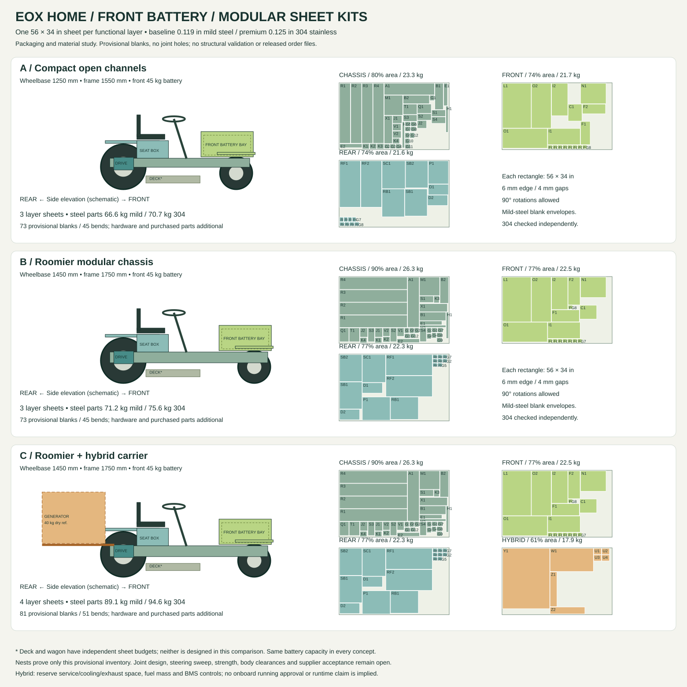

# Home: front battery and a sheet per layer

Concept study, 2026-10-22. The [product brief](product-brief.md) controls the
design. These are new packaging and material-budget candidates, independent
of the legacy H0 vehicle simulation and the earlier closed-rail study.



## What the first comparison produces

| Candidate | Wheelbase / frame | Reference sheets | Mild-steel parts | 304 parts |
|---|---|---:|---:|---:|
| A: compact open channels | 1250 / 1550 mm | 3 | 66.6 kg | 70.7 kg |
| B: roomier modular chassis | 1450 / 1750 mm | 3 | 71.2 kg | 75.6 kg |
| C: B plus removable hybrid carrier | 1450 / 1750 mm, carrier additional | 4 | 89.1 kg | 94.6 kg |

Masses are fabricated parts only: battery, motors, transmission, wheels,
steering hardware, seat, fasteners, finish, generator and fuel are additional.
The same 520 × 270 × 220 mm, 45 kg reference battery is retained in all
candidates. No smaller battery or reduced runtime target is used to make a fit.

Each sheet is 56 × 34 in / 1422.4 × 863.6 mm. Baseline is supplier-listed
0.119 in / 3.023 mm mild steel; premium is the requested 0.125 in / 3.175 mm
304 stainless. Stainless uses its own bend radius, allowance and minimum
flange checks. This is a manufacturing/material comparison, not evidence
that either variant has adequate structural strength.

**B is the preferred next detailing candidate**, based on its additional
packaging room for a modest material increase over A. That is a provisional
packaging judgement, not a validated handling or strength result. C shows
the consequence of adding the generator; it does not require every electric
tractor buyer to purchase that carrier.

## Sheet boundaries

| Layer | Included fabricated parts | B baseline area used |
|---|---|---:|
| Chassis | Four half-length side channels; splice plates; front battery supports, restraints and end stops; crossmember; motor and bearing supports; front axle channel, pivot cheeks and kingpin supports; steering support; hitch; 12 mount/hanger/gusset allowance blanks | 90.3% |
| Front | Hood top, two sides and end; two front fenders; footrests; cowl/control support; eight body-mount allowance blanks | 77.3% |
| Rear | Seat bridge, box sides/rear and service cover; two rear fenders; drive guards; eight body-mount allowance blanks | 76.7% |
| Optional hybrid | Carrier tray, braces, heat-shield allowance and four mount doublers | 61.4% |
| Mower deck | Independent attachment sheet budget; not designed in this study | — |
| Wagon | Independent module, potentially several sheets; not designed in this study | — |

Every listed quantity is included in its nest. Generic bracket blanks are
explicit material reserves that must be replaced by actual connection
designs. The 73 blanks and 45 bends for A/B are a starting point, with
substantial opportunity to reduce assembly work and supplier operations.

## What the nests establish

`src/eox/home_concepts.py` uses the existing `FlangedPanel` bend model to
compute unperforated flat geometry, corner reliefs, bounding envelopes and
mass. A deterministic rectangle-packing search places every blank instance.
A separate validator checks quantities, rotated dimensions, overlaps,
inter-part gaps and sheet edges. All 20 layer/material combinations fit.

The study reserves 4 mm between bounding boxes and 6 mm at sheet edges and
allows 90-degree rotations. These assumptions need supplier confirmation,
including any grain/bend orientation restrictions. The preview displays
conservative rectangular envelopes rather than detailed cut outlines.
Utilization figures use actual gross flat area, not the bounding-box area.

Each individual part also passes the existing basic size, flange and bend
length screens. This does not check tooling access or a complete bending
sequence. Supplier acceptance and actual quotes remain outstanding.

## Front battery and hybrid packaging

The battery sits behind/above the front axle in the former engine position;
the electric drive sits at the rear. Before fixing its height, check front
wheel sweep, axle roll, front-axle loading, steering effort, deck travel,
rear-wheel traction and battery removal. Long power cables and protection
placement must be included in cost, voltage-drop and thermal checks. Reserve
a separate purchased electrical case for distribution equipment; the hood
does not by itself establish electrical weather protection.

The K&S product page gives a 510 × 525 × 310 mm envelope. Its linked manual
instead gives 27.5 × 18.7 × 22.4 in and 88 lb. Until the exact revision is
confirmed, reserve their combined bounding envelope, rounded to
700 × 530 × 570 mm, and 40 kg dry, excluding fuel and installation clearance.
These conflicting official values preclude a final mounting design. [1][2]

The manual specifies 3.6 kW / 70 A battery charging, approximately 53.5–54 V
regulation, and external dry-contact control. It forbids directly supplying
loads. Confirm support for simultaneous battery charging and traction/PTO
operation, BMS charge limits, disconnect behavior and mobile use. A 54 V
source is below the reference 16S pack's 58.4 V full-charge setting; do not
assume full charging or cell balancing. [2]

The rear carrier also needs load-path checks, fuel/heat isolation, exhaust
away from the operator, cooling and service access, vibration isolation and
an appropriate stop/interlock strategy. Preserve the generator's CO
protection. The portable unit is a candidate, not an approved onboard
installation. Battery buffering remains necessary for power peaks; no
hybrid runtime figure is claimed.

## Cost and manufacture

Use mild steel with a quoted corrosion-protection finish as the cost
baseline. Treat 304 as the premium corrosion-resistance option; its cost
premium is unknown until the same part set is quoted in both materials.
In this geometry the stainless sheet parts weigh about 6% more. Structural
properties, springback, radii, holes and fits must be evaluated separately.

Retain the requested 56 × 34 in reference-sheet constraint. SendCutSend's
current mild-steel cutting chart actually lists 44 × 30 in instant sizing
and 56 × 44 in custom sizing; individual bent blanks are separately limited
to 30 × 44 in. At 0.125 in, 304's listed maximum bend length is 40 in. The
study stays within those individual bending limits. [3][4]

SendCutSend asks for individually submitted parts when bending/additional
processes are required. These layer nests are reproducible material-budget
references, not promises about the supplier's actual production nesting or
pricing. Obtain a complete per-part cut/bend/finish quote. [5]

## Reproduce and continue

```sh
uv run python -m eox.home_concepts
uv run pytest -q tests/test_home_concepts.py tests/test_sheetmetal.py
```

Configuration is `design/home-concepts.toml`. Outputs under
`out/home-concepts/` include the comparison SVG, report, JSON summary and
per-material/concept/layer inventory CSVs and placement JSONs. Units are mm
and kg. The repository image is a copy of the generated SVG.

Next, replace the bracket allowances with accessible bolted joints and
complete the formed assembly. Reduce unique parts, unnecessary bends and
bodywork weight; improve the margins in B's densely packed chassis sheet.
Add actual powertrain, brake and steering interfaces. Recheck the nest
after each change and feed the resulting masses/geometry into corrected
vehicle physics before running a larger ML2 optimization. Physical load,
assembly and mowing tests are needed before recommending an order package.

## Sources

Checked 2026-10-22.

1. [Könner & Söhnen KS 48DC-S CO product page](https://konner-sohnen.us/products/generator-ks-48v-dc).
2. [Manufacturer-linked KS 48DC-S CO manual](https://konner-sohnen.us/cdn/shop/files/direct-current-generator-KS-48V-DC_en-US.pdf?v=1147498246804723505).
3. [SendCutSend cutting size chart](https://sendcutsend.com/materials/min-max/).
4. [SendCutSend processing size chart](https://sendcutsend.com/materials/processing-min-max/).
5. [SendCutSend cutting/nesting guidelines](https://sendcutsend.com/guidelines/sheet-cutting/).
