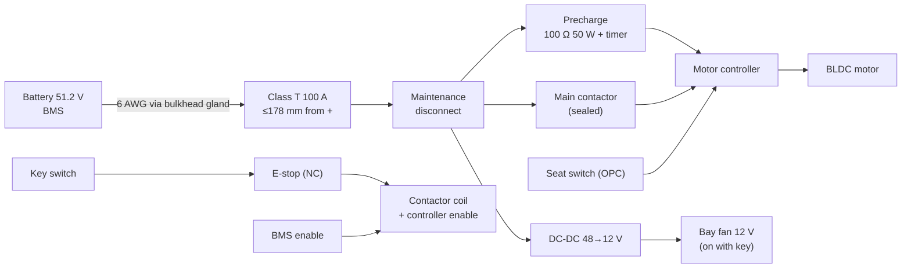

# Power box (module 1)


The power box is a self-contained drive module. It holds the battery, traction
motor, controller and protection in a folded aluminium enclosure. The motor
shaft comes out of the side wall to take a #40 chain sprocket. Everything is
sized from `design/powerbox.toml`; run `uv run eox calc` for current numbers.

## Rev A1 at a glance

| | |
|---|---|
| Outer size | ≈ 809 × 346 × 268 mm (L × W × H, cover on) |
| Mass | ≈ 70 kg incl. hardware, of which the battery is 45 kg |
| Battery | 51.2 V 100 Ah LiFePO4 (5.1 kWh), UL 2271 listed, in a **sealed** bay |
| Motor | 48 V BLDC, 2 kW rated, 15 N·m peak, 3/4 in keyed shaft, in a **ventilated** bay |
| Drive runtime | ≈ 5.7 h at mowing pace, mower deck not included |
| Sheet metal | 5052-H32, 0.125 in (3.175 mm), 8 SendCutSend parts. The motor doubler is 0.250 in, laser cut only. |
| Purchased parts | ≈ $2,130 budgetary, plus the SCS quote |
| Checks | 0 FAIL, 5 WARN |

**What changed in A1:**

- **Bulkhead.** A new part (PB-106) splits the box into a sealed battery bay
  and a ventilated motor bay.
- **Inlet.** Floor slots in the motor bay let filtered air in.
- **Exhaust.** An 80 mm fan blows out through the cover end wall.
- **Result.** In the screening model the pack runs at ≈ 44 °C, down from 66 °C,
  in 35 °C sun.

## Why a clamshell and not one folded box

SendCutSend limits:

- **Flat blank size:** at most 30 × 44 in for bending.
- **Channels:** a U-channel's base must be at least 2 × its flange.

A one-piece 5-sided box deep enough for the battery breaks both rules. So the
enclosure is two shallow trays:

- **PB-101 tray:** 150 mm walls; holds everything.
- **PB-102 cover:** 148 mm walls; slips over the tray with a 30 mm gasketed
  overlap.

The flats are 1089 × 627 mm and 1094 × 631 mm, which is **97–98 % of the bend
limit** (WARN). The battery length and the bulkhead gap set that, so **a longer
battery means a different layout**: the `SCS PB-10x flat ... fits` checks will
tell you. The seam where the shells overlap is also a natural crease line for
the low-poly look.

## Two bays

```
 -x                                                                      +x
 | stop |        battery 520         | stop | bulkhead | motor · electrics · controller | fan → out
 |<--------- sealed battery bay ------------>|          |<-- ventilated "wet" motor bay -->|
                                                         ↑ filtered floor slots (inlet + drain)
```

**Sealed battery bay.**

- Enclosed by the cover gasket, the corner sealant, and foam on the bulkhead's
  side and top flanges.
- Battery cables and BMS comms reach the motor bay through IP68 glands in the
  bulkhead.
- The M12 breather vent on the −x end equalises pressure without letting water
  in.

**Ventilated motor bay ("wet zone").**

- **Inlet:** 30 floor slots (92 cm²) under the motor and controller, faced with
  a replaceable foam filter. They face down, so rain can't fall in, and they
  drain any water that does get in.
- **Exhaust:** an IP68 80 mm fan runs whenever the key is on and blows out
  through the cover's +x end wall behind a finger guard.
- **Rule: everything in this bay must be IP65 or better.** That covers the
  controller, the DC-DC, a sealed contactor, a covered fuse holder and sealed
  terminals. The BOM specs reflect it.

**Thermal results** from the screening model, two zones, at 35 °C with full sun
and still air:

| Case | Pack | Motor bay air |
|---|---|---|
| Rev A0, one sealed box (for reference) | 65.8 °C (FAIL) | — |
| Mowing, fan running | **44.1 °C** | 42.8 °C (controller full-power limit 55 °C) |
| Mowing, fan failed (stack-effect flow only) | **46.2 °C** | 66 °C: controller derates itself |
| Parked in sun, charging at 15 A | 42.9 °C (WARN, 45 °C limit) | — |

A failed fan costs power, not safety: the pack stays under its rating.

## Parts

| Part | What | Notes |
|---|---|---|
| PB-101 | Tray (lower shell) | **+y wall:** motor bolt circle and spigot. **−y wall:** controller rivnuts. **+x end:** cable glands. **Floor:** frame mounts, clamp-rod rivnuts, bulkhead rivets, 30 inlet slots. |
| PB-102 | Cover (upper shell) | 8 × M5 into rivnuts on the tray. Fan opening and screws on the +x end; M12 breather on the −x end. |
| PB-103 | Motor doubler | 0.250 in plate behind the motor wall; spreads bolt bearing and stiffens the wall |
| PB-104 ×2 | Battery clamp bar | U-channel across the pack top; M8 rods down to floor rivnuts |
| PB-105 ×2 | Battery stop | L-angle riveted at each end of the pack; takes crash load in x |
| PB-106 | Bulkhead | 4-flange panel. Bottom flange riveted to the floor (5 rivets); side and top flanges carry 10 mm foam; M25 + M20 glands. **Air barrier only**: the stops carry the crash load. |

`uv run eox build` writes `out/cad/PB-xxx.step` (order these from SCS) and
`PB-xxx_flat.dxf` (reference flat with `BEND` layer), plus an assembly STEP.

## Electrical single-line



Negative returns to the pack go through the BMS. The chassis is not used as a
conductor. The fuse must sit within 178 mm of the battery's + terminal (33 CFR
183.455), so mount the fuse holder on the bay side of the bulkhead, right at
the M25 gland.

## Assembly sequence

1. Install the rivnuts in the tray:
   - M8: 4 frame mounts + 4 clamp rods, in the floor;
   - M6: 4 for the controller, on the −y wall;
   - M5: 8 for the cover.
2. Rivet both battery stops (PB-105) and the bulkhead (PB-106) to the floor.
3. Seal the 4 tray corner reliefs, the 4 cover corner reliefs, and the
   bulkhead's bottom flange-to-floor joint with MS-polymer.
4. Apply 10 mm foam to the bulkhead's side and top flanges. Fit the bulkhead
   glands.
5. Mount the motor through the +y wall: motor flange inside, then the wall,
   then the doubler. Use M8 8.8 bolts with nyloc nuts.
6. Mount the controller on the −y wall with a thermal pad.
7. Bond the inlet filter (foam + mesh) inside, over the floor slots.
8. Build the electrics plate on the floor between the controller and the motor:
   fuse right at the bulkhead gland, contactor, precharge, DC-DC.
9. Lay the pads, drop in the pack, fit the clamp bars (PB-104) and rods, and
   preload to about 800 N per rod. Pass the cables through the bulkhead glands.
10. Route the harness through the end-wall glands and fit the breather.
11. Fit the fan and guard to the cover, and plug in its connector.
12. Apply EPDM tape to the tray walls in the overlap band, then fit the cover
    with 8 × M5.

## Known issues (rev A1)

1. **Flats at 97–98 % of SCS's 30 × 44 in bend limit (WARN).**
   - There is about 25 mm of length left.
   - If a real battery is longer than the 520 mm REF, the layout has to change.
     One option is a shorter cover with a separate end panel.
2. **Charging in sun (WARN).**
   - The pack reaches 42.9 °C against its 45 °C charge rating.
   - Charge in shade. Most LFP BMSs block charging above 45 °C.
3. **Mounting clearance.**
   - The floor inlet needs air underneath the box.
   - Mount the box on rails or standoffs; at least 15 mm of clear gap is
     suggested.
   - Keep the fan exhaust clear of the operator's legs and of grass discharge.
4. **The thermal model is a screening estimate.**
   - It is steady state, uses still outside air, and ignores the pack's thermal
     mass.
   - The fan's delivered flow (30 m³/h) is a REF value.
   - Validate with thermocouples on a prototype: pack surface, bay air,
     controller baseplate.
5. **REF parts.** The battery, motor, controller and fan are generic envelopes.
   Replace them with datasheet values before ordering metal.
6. **REF hardware ratings.** The rivnut pull-out and rivet shear values are
   placeholders. Confirm them with supplier data.
