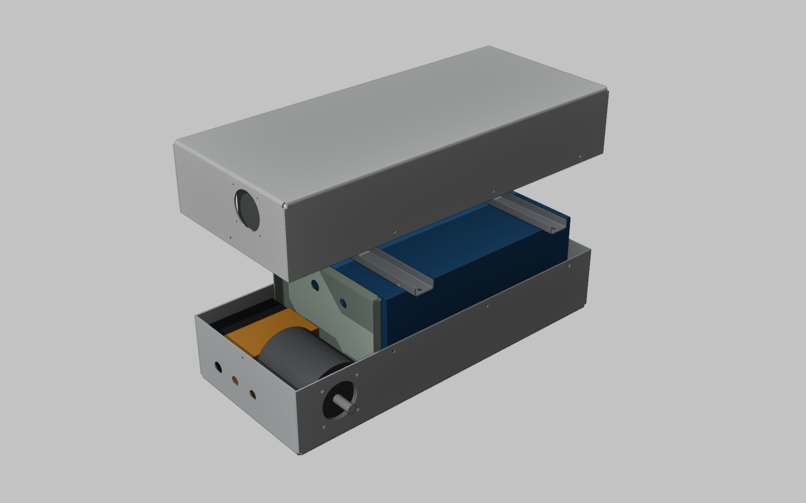
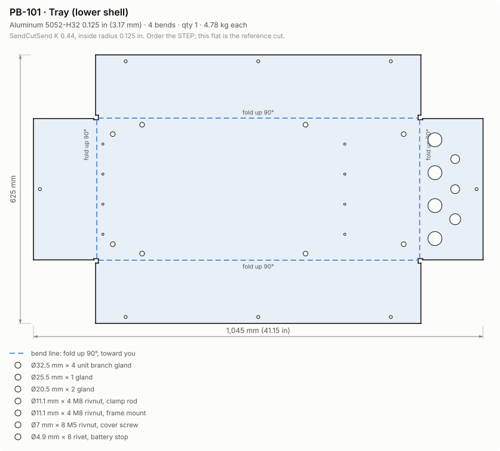
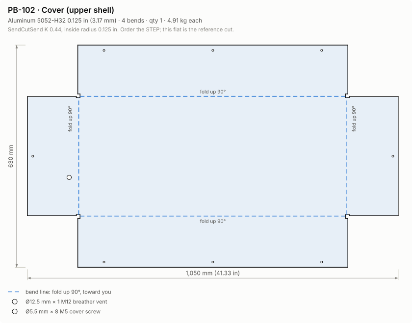
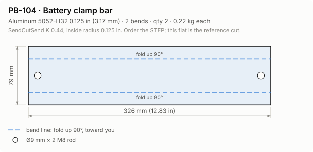
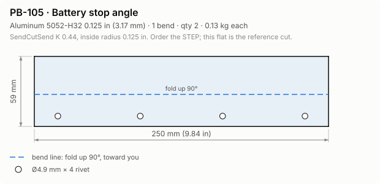
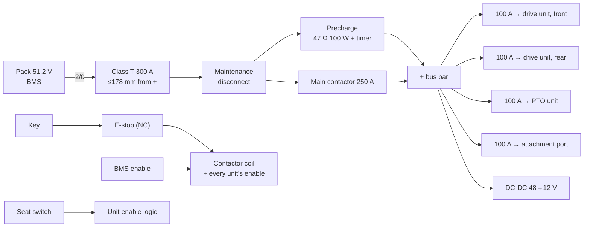

# Battery & distribution box (shared module)

The box is the hub of the 48 V bus (see [architecture](architecture.md)). It
holds the LiFePO4 pack, the main protection, and one fused branch per 3 HP
unit. Every EOX model uses the same box. It is sized from
`design/powerbox.toml`; run `uv run eox calc` for current numbers.

## Rev B0 at a glance

| | |
|---|---|
| Outer size | 765 × 345 × 268 mm (L × W × H, cover on) |
| Mass | ≈ 60 kg with hardware, of which the pack is 45 kg |
| Pack | 51.2 V 100 Ah LiFePO4 (5.1 kWh), BMS ≥ 200 A continuous / 400 A peak, UL 2271 or IEC 62619 listed |
| Main protection | 300 A Class T fuse, 250 A contactor, 47 Ω timed precharge, maintenance disconnect, 2/0 AWG cable |
| Unit branches | 4 × 100 A fuse, 6 AWG, M32 gland each: 2 drive + PTO + attachment |
| Sheet metal | 5052-H32, 0.125 in (3.175 mm), 6 SendCutSend parts |
| Purchased parts | ≈ $1,740 budgetary, plus the SCS quote |

**What changed from A1.**

- **No motor in the box.** The motors moved onto the axle modules and
  attachments, so the A1 motor bay, bulkhead, fan, vents and motor doubler are
  gone.
- **Sealed and shorter.** The box is sealed again and 44 mm shorter.
- **Rated for the bus.** It carries the higher bus current: 197 A continuous
  for 3 units at once, against 55 A before.

## Why a clamshell and not one folded box

SendCutSend limits:

- **Flat blank size:** at most 30 × 44 in for bending.
- **Channels:** a U-channel's base must be at least 2 × its flange.

A one-piece 5-sided box deep enough for the pack breaks both rules. So the
enclosure is two shallow trays:

- **PB-101 tray:** 150 mm walls; holds everything.
- **PB-102 cover:** 148 mm walls; slips over the tray with a 30 mm gasketed
  overlap.

The flats are 1045 × 625 mm and 1050 × 630 mm, which is 94 % of the bend limit.
That leaves about 70 mm for a longer pack. The seam where the shells overlap is
also a natural crease line for the low-poly look.

## Parts

| Part | What | Notes |
|---|---|---|
| PB-101 | Tray (lower shell) | **+x end wall:** 4 unit-branch glands (M32) and 3 small glands. **Floor:** frame mounts, clamp-rod rivnuts, stop rivets. **Walls:** rivnuts for the cover screws. |
| PB-102 | Cover (upper shell) | 8 × M5 into the tray rivnuts; M12 breather vent high on the −x end |
| PB-104 ×2 | Battery clamp bar | U-channel across the pack top; M8 rods down to floor rivnuts |
| PB-105 ×2 | Battery stop | L-angle riveted at each end of the pack; takes the crash load in x |

`uv run eox build` writes `out/cad/powerbox/PB-xxx.step` (order these from SCS)
and `PB-xxx_flat.dxf` (reference flat with a `BEND` layer), plus an assembly
STEP. `uv run eox drawings` regenerates the cut diagrams below.

<picture>
  <source media="(prefers-color-scheme: dark)" srcset="img/flats/PB-101-dark.svg">
  
</picture>

<picture>
  <source media="(prefers-color-scheme: dark)" srcset="img/flats/PB-102-dark.svg">
  
</picture>

| | |
|---|---|
| <picture><source media="(prefers-color-scheme: dark)" srcset="img/flats/PB-104-dark.svg"></picture> | <picture><source media="(prefers-color-scheme: dark)" srcset="img/flats/PB-105-dark.svg"></picture> |

## Electrical single-line

- **Returns:** negatives go back to the pack through the BMS. The chassis is
  not used as a conductor.
- **Branch interface:** each branch leaves through its own gland. Use an
  Anderson SB120 for power and a Deutsch DT 6-pin for enable, interlock and CAN
  (see the 3 HP unit standard in [architecture](architecture.md)).

## Thermal

The box is sealed. While mowing, about 66 W is generated inside, mostly the
pack's own I²R at 56 A, and the lid picks up about 66 W from the sun.

The pack weighs 45 kg and its thermal time constant is about 3.9 h, so a
mowing run never reaches steady state. The check is the pack temperature at
the end of a full run (1.4 h), starting heat-soaked in the sun:

| | Pack temperature |
|---|---|
| Starting heat-soaked in the sun | 43 °C |
| End of a full mowing run in 35 °C sun | **48 °C** (rating 60 °C) |
| Steady state, if it ran forever | 61 °C |

Parked in the sun while charging at 15 A it reaches 43.9 °C, a WARN against the
45 °C charge rating. Charge in shade, and let a hot pack cool before charging.

## Assembly sequence

1. Install the rivnuts in the tray:
   - M8: 4 frame mounts + 4 clamp rods, in the floor;
   - M5: 8 for the cover.
2. Rivet both battery stops (PB-105) to the floor.
3. Seal the 4 tray corner reliefs and the 4 cover corner reliefs with
   MS-polymer.
4. Build the distribution bay on the floor at the +x end:
   - main fuse at the pack + terminal;
   - disconnect, contactor and precharge;
   - bus bars and the 4 branch fuses;
   - the DC-DC converter.
5. Fit the glands: 4 × M32 branch, M25 charge inlet, 2 × M20.
6. Lay the pads, drop in the pack, fit the clamp bars (PB-104) and rods, and
   preload to about 800 N per rod.
7. Fit the breather. Apply EPDM tape to the tray walls in the overlap band,
   then fit the cover with 8 × M5.

## Known issues (rev B0)

1. **Pack capacity (WARN).**
   - One 100 Ah pack gives the Pro 1.3 h of mowing and the Home 1.46 h; the
     target is 1.5 h.
   - Transport and backhoe runtimes are also below target.
   - 70 mm of flat length is left for a longer pack. Beyond that, the options
     are a second pack or swapping.
2. **Bus current near the pack rating (WARN).** 197 A against a 200 A
   continuous BMS when 3 units run at rated power.
3. **REF ratings.** These are placeholders; confirm each on its datasheet:
   - branch fuse DC voltage and interrupt ratings;
   - rivnut pull-out;
   - rivet shear.
4. **Pack candidates.**
   [docs/component-candidates.md](component-candidates.md) was written for
   rev A1, when the pack only needed 100 A.
   - Re-check the recommended pack against the new ≥ 200 A continuous
     requirement.
   - Its motor and controller picks are superseded by golf-cart units.
