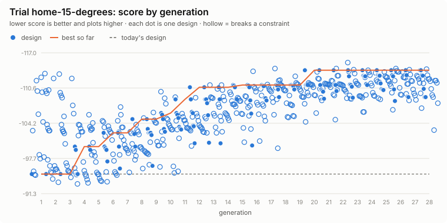

# Trial: home-15-degrees

**Question.** What would it take to rate the Home for 15 deg climbs: gearing, tyre pressure, and where the operator, deck and battery sit?

Generated 2026-10-21 by `uv run eox evolve --trial home-15-degrees` from `design/trials/home-15-degrees.toml`: 20 designs x 28 generations (stopped early: no better design for 8), seed 1; 505 distinct designs evaluated (80 feasible), 67 CPU-minutes. Each design runs the full `eox calc` checks and the terrain course (deck). Fixed for every design: `course.lod` = low.

## Answer: the best design against today's

| Metric | Today | Best | |
|---|---|---|---|
| steepest climb on grip, deck fitted | 14.2 | **15.6** | deg |
| motor torque on the rated climb, deck fitted | 3.17 | **2.27** | x rated |
| max working slope (half the lowest static tip angle) | 22.7 | **22.7** | deg |
| course obstacles that WARN | 2 | **2** |  |
| longest wheel lift, summed over the obstacles | 2.6 | **2.56** | s |
| float the deck's hitch needs (worst obstacle) | 105 | **107** | mm |
| lightest wheel load on the side slope | 0.03 | **0.03** | N |
| machine mass with the deck, no operator | 302 | **302** | kg |
| purchased parts, budgetary | 3,714 | **3,714** | $ |
| runtime on one charge, mowing | 1.45 | **1.47** | h |
| engineering checks that FAIL | 0 | **0** |  |
| engineering checks that WARN | 4 | **5** |  |
| course obstacles that FAIL (stuck, rolled, left the course) | 0 | **0** |  |

**Score** (lower is better): today -94.90; best -113.80.

| Gene | Why | Range | Today | Best |
|---|---|---|---|---|
| `vehicle.max_slope_deg` | the climb rating itself | 12 to 16 | 12 | **15.5** (range limit) |
| `axle.ratio` | stock, 15:1 gear set, or a 2:1 chain stage | 12.4 / 15 / 24.8 | 15 | **24.8** |
| `axle.tire_pressure_kpa` | drive-tyre pressure (8-22 psi) | 55 to 152 | 83 | **55** (range limit) |
| `layout.operator_cg.0` | operator fore-aft | 250 to 700 | 520 | **540** |
| `layout.powerbox_x` | battery box fore-aft, slung low between the rails | 450 to 900 | 510 | **520** |
| `deck.x_center` | mid-mount deck fore-aft | 560 to 1060 | 800 | **610** |
| `deck.pto_unit_y` | where the PTO unit stands | 430 / -430 / 480 / -480 | 430 | **430** |

At a range limit: `vehicle.max_slope_deg`, `axle.tire_pressure_kpa`. The best value may lie beyond it; widen the range if the design allows, or treat the limit as a real constraint.

Course warnings on the best design: deck twist: front L wheel lifts 0.8 s; deck needs 107 mm of float (has 75); deck side slope 17 deg: front L wheel lifts 1.5 s.

## Leaderboard

| # | Score | `max_slope_deg` | `ratio` | `tire_pressure_kpa` | `operator_cg.0` | `powerbox_x` | `x_center` | `pto_unit_y` | Grip | Working slope | Course WARN | Mass |
|---|---|---|---|---|---|---|---|---|---|---|---|---|
| 1 | -113.80 | 15.5 | 24.8 | 55 | 540 | 520 | 610 | 430 | 15.6 | 22.7 | 2 | 302 |
| 2 | -113.80 | 15.5 | 24.8 | 55 | 540 | 520 | 610 | -430 | 15.6 | 22.7 | 2 | 302 |
| 3 | -112.90 | 15.5 | 15 | 55 | 540 | 520 | 560 | 430 | 15.7 | 22.7 | 3 | 302 |
| 4 | -112.80 | 15.5 | 15 | 55 | 560 | 520 | 560 | 430 | 15.6 | 22.7 | 3 | 302 |
| 5 | -112.80 | 15.5 | 15 | 55 | 540 | 520 | 610 | 430 | 15.6 | 22.7 | 3 | 302 |
| 6 | -112.80 | 15.5 | 15 | 55 | 540 | 520 | 610 | -480 | 15.6 | 22.7 | 3 | 302 |
| 7 | -112.70 | 15.5 | 15 | 55 | 540 | 520 | 640 | 430 | 15.5 | 22.7 | 3 | 302 |
| 8 | -112.70 | 15.5 | 15 | 55 | 540 | 520 | 640 | 480 | 15.5 | 22.7 | 3 | 302 |
| 9 | -112.70 | 15.5 | 15 | 55 | 540 | 520 | 670 | -430 | 15.5 | 22.7 | 3 | 302 |
| 10 | -111.40 | 15 | 24.8 | 55 | 540 | 520 | 560 | -480 | 15.7 | 22.7 | 2 | 302 |

## Progress

<picture>
  <source media="(prefers-color-scheme: dark)" srcset="progress-dark.svg">
  
</picture>

## Adopting

`best.toml` lists the best design's changed values as `[overrides]` for `design/models/home.toml`. A trial is evidence for a decision, not the decision: review the numbers above, then edit the model file in a pull request, so the change and its reasons are recorded.

Objectives and constraints:

- max `rated_slope_deg` (rated climb (vehicle.max_slope_deg)), weight 5 per 1 deg
- max `grip_limit_deg` (steepest climb on grip, deck fitted), weight 1 per 1 deg
- max `working_slope_deg` (max working slope (half the lowest static tip angle)), weight 1 per 1 deg
- min `course_warns` (course obstacles that WARN), weight 1 per 1 
- constraint: `calc_fails` <= 0
- constraint: `course_fails` <= 0
