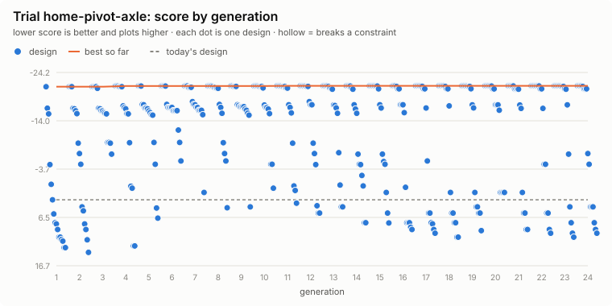

# Trial: home-pivot-axle

**Question.** Should the Home's front axle pivot, how far, and what springs, to keep all four wheels down without giving up too much stability?

Generated 2026-10-21 by `uv run eox evolve --trial home-pivot-axle` from `design/trials/home-pivot-axle.toml`: 16 designs x 24 generations, seed 1; 323 distinct designs evaluated (323 feasible), 145 CPU-minutes. Each design runs the full `eox calc` checks and the terrain course (deck, bare).

## Answer: the best design against today's

| Metric | Today | Best | |
|---|---|---|---|
| steepest climb on grip, deck fitted | 14.2 | **14.2** | deg |
| motor torque on the rated climb, deck fitted | 3.17 | **3.17** | x rated |
| max working slope (half the lowest static tip angle) | 22.7 | **19.8** | deg |
| course obstacles that WARN | 4 | **1** |  |
| longest wheel lift, summed over the obstacles | 5.82 | **0.14** | s |
| float the deck's hitch needs (worst obstacle) | 108 | **108** | mm |
| lightest wheel load on the side slope | 0 | **403** | N |
| machine mass with the deck, no operator | 302 | **302** | kg |
| purchased parts, budgetary | 3,714 | **3,714** | $ |
| runtime on one charge, mowing | 1.45 | **1.45** | h |
| engineering checks that FAIL | 0 | **0** |  |
| engineering checks that WARN | 4 | **4** |  |
| course obstacles that FAIL (stuck, rolled, left the course) | 0 | **0** |  |

**Score** (lower is better): today 2.76; best -21.41.

| Gene | Why | Range | Today | Best |
|---|---|---|---|---|
| `steer_axle.oscillates` | leaf springs only, or a centre pivot | false / true | false | **true** |
| `steer_axle.oscillation_max_deg` | pivot stop angle (only with a pivot) | 5 to 15 | 10 | **15** (range limit) |
| `steer_axle.spring_travel` | leaf-spring travel each way, mm | 30 to 80 | 40 | **65** |
| `steer_axle.spring_rate_n_per_mm` | each leaf spring's rate | 10 to 40 | 20 | **24** |

At a range limit: `steer_axle.oscillation_max_deg`. The best value may lie beyond it; widen the range if the design allows, or treat the limit as a real constraint.

Course warnings on the best design: deck twist: deck needs 108 mm of float (has 75).

## Leaderboard

| # | Score | `oscillates` | `oscillation_max_deg` | `spring_travel` | `spring_rate_n_per_mm` | Grip | Working slope | Course WARN | Mass |
|---|---|---|---|---|---|---|---|---|---|
| 1 | -21.41 | true | 15 | 65 | 24 | 14.2 | 19.8 | 1 | 302 |
| 2 | -21.41 | true | 15 | 55 | 24 | 14.2 | 19.8 | 1 | 302 |
| 3 | -21.41 | true | 15 | 40 | 24 | 14.2 | 19.8 | 1 | 302 |
| 4 | -21.41 | true | 15 | 80 | 24 | 14.2 | 19.8 | 1 | 302 |
| 5 | -21.41 | true | 15 | 30 | 24 | 14.2 | 19.8 | 1 | 302 |
| 6 | -21.41 | true | 15 | 50 | 24 | 14.2 | 19.8 | 1 | 302 |
| 7 | -21.41 | true | 15 | 75 | 24 | 14.2 | 19.8 | 1 | 302 |
| 8 | -21.41 | true | 15 | 45 | 24 | 14.2 | 19.8 | 1 | 302 |
| 9 | -21.41 | true | 15 | 60 | 24 | 14.2 | 19.8 | 1 | 302 |
| 10 | -21.41 | true | 15 | 70 | 24 | 14.2 | 19.8 | 1 | 302 |

## Progress

<picture>
  <source media="(prefers-color-scheme: dark)" srcset="progress-dark.svg">
  
</picture>

## Adopting

`best.toml` lists the best design's changed values as `[overrides]` for `design/models/home.toml`. A trial is evidence for a decision, not the decision: review the numbers above, then edit the model file in a pull request, so the change and its reasons are recorded.

Objectives and constraints:

- min `wheel_lift_s` (longest wheel lift, summed over the obstacles), weight 3 per 1 s
- min `course_warns` (course obstacles that WARN), weight 2 per 1 
- max `working_slope_deg` (max working slope (half the lowest static tip angle)), weight 1 per 1 deg
- max `side_slope_wheel_n` (lightest wheel load on the side slope), weight 1 per 100 N
- constraint: `calc_fails` <= 0
- constraint: `course_fails` <= 0
