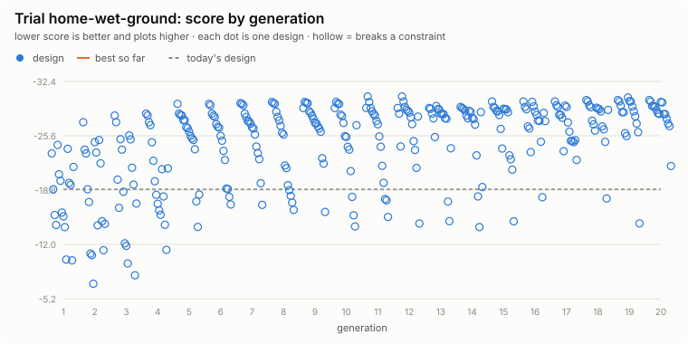

# Trial: home-wet-ground

**Question.** How should the Home be set up for soft wet ground: tyre pressures, and where the operator, deck and battery sit?

Generated 2026-10-21 by `uv run eox evolve --trial home-wet-ground` from `design/trials/home-wet-ground.toml`: 16 designs x 20 generations, seed 1; 282 distinct designs evaluated (0 feasible), 153 CPU-minutes. Each design runs the full `eox calc` checks and the terrain course (deck). Fixed for every design: `ground.cone_index_kpa` = 200, `vehicle.max_slope_deg` = 5.

## Answer: the best design against today's

| Metric | Today | Best | |
|---|---|---|---|
| steepest climb on grip, deck fitted | 6.3 | **8.1** | deg |
| motor torque on the rated climb, deck fitted | 2.36 | **2.25** | x rated |
| max working slope (half the lowest static tip angle) | 22.7 | **22.7** | deg |
| course obstacles that WARN | 0 | **2** |  |
| longest wheel lift, summed over the obstacles | 7.58 | **4.2** | s |
| float the deck's hitch needs (worst obstacle) | 107 | **107** | mm |
| lightest wheel load on the side slope | 0.06 | **0.09** | N |
| machine mass with the deck, no operator | 302 | **302** | kg |
| purchased parts, budgetary | 3,714 | **3,714** | $ |
| runtime on one charge, mowing | 1.26 | **1.3** | h |
| engineering checks that FAIL | 0 | **0** |  |
| engineering checks that WARN | 5 | **5** |  |
| course obstacles that FAIL (stuck, rolled, left the course) | 3 | **1** |  |

**Score** (lower is better): today -18.92 (breaks a constraint); best -30.08 (breaks a constraint: no feasible design found).

| Gene | Why | Range | Today | Best |
|---|---|---|---|---|
| `axle.tire_pressure_kpa` | drive-tyre pressure (8-22 psi) | 55 to 152 | 83 | **55** (range limit) |
| `steer_axle.tire_pressure_kpa` | steering-tyre pressure | 55 to 152 | 97 | **55** (range limit) |
| `layout.operator_cg.0` | operator fore-aft | 250 to 700 | 520 | **560** |
| `layout.powerbox_x` | battery box fore-aft | 450 to 900 | 510 | **520** |
| `deck.x_center` | mid-mount deck fore-aft | 560 to 1060 | 800 | **560** (range limit) |

At a range limit: `axle.tire_pressure_kpa`, `steer_axle.tire_pressure_kpa`, `deck.x_center`. The best value may lie beyond it; widen the range if the design allows, or treat the limit as a real constraint.

The best design still fails: course deck: kerb stuck.

Course warnings on the best design: deck twist: front L wheel lifts 2.7 s; deck needs 107 mm of float (has 75); deck side slope 17 deg: front L wheel lifts 1.4 s.

Today's design, scored by this trial, fails: course deck: kerb stuck; course deck: twist stuck; course deck: side slope 17 deg stuck.

## Leaderboard

| # | Score | `tire_pressure_kpa` | `tire_pressure_kpa` | `operator_cg.0` | `powerbox_x` | `x_center` | Grip | Working slope | Course WARN | Mass |
|---|---|---|---|---|---|---|---|---|---|---|
| | no feasible design | |

## Progress

<picture>
  <source media="(prefers-color-scheme: dark)" srcset="progress-dark.svg">
  
</picture>

## Adopting

`best.toml` lists the best design's changed values as `[overrides]` for `design/models/home.toml`. A trial is evidence for a decision, not the decision: review the numbers above, then edit the model file in a pull request, so the change and its reasons are recorded.

Objectives and constraints:

- max `grip_limit_deg` (steepest climb on grip, deck fitted), weight 3 per 1 deg
- min `course_energy_wh` (drive energy for the course), weight 1 per 2 Wh
- max `working_slope_deg` (max working slope (half the lowest static tip angle)), weight 1 per 1 deg
- min `course_warns` (course obstacles that WARN), weight 1 per 1 
- constraint: `calc_fails` <= 0
- constraint: `course_fails` <= 0
