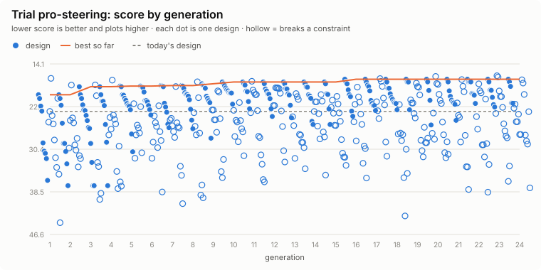

# Trial: pro-steering

**Question.** What is the smallest, lowest-draw steering cylinder setup that gives the Pro a 25-40 % margin with the deck and steers lock to lock in about 3 s?

Generated 2026-10-21 by `uv run eox evolve --trial pro-steering` from `design/trials/pro-steering.toml`: 20 designs x 24 generations (stopped early: no better design for 8), seed 1; 422 distinct designs evaluated (158 feasible), 22 CPU-minutes. Each design runs the full `eox calc` checks and the terrain course (no course runs).

## Answer: the best design against today's

| Metric | Today | Best | |
|---|---|---|---|
| steepest climb on grip, deck fitted | 22.7 | **22.7** | deg |
| motor torque on the rated climb, deck fitted | 2.65 | **2.65** | x rated |
| max working slope (half the lowest static tip angle) | 20.2 | **20.2** | deg |
| course obstacles that WARN | 0 | **0** |  |
| longest wheel lift, summed over the obstacles | 0 | **0** | s |
| float the deck's hitch needs (worst obstacle) | 0 | **0** | mm |
| lightest wheel load on the side slope | 0 | **0** | N |
| machine mass with the deck, no operator | 371 | **371** | kg |
| purchased parts, budgetary | 5,338 | **5,338** | $ |
| runtime on one charge, mowing | 1.32 | **1.31** | h |
| engineering checks that FAIL | 0 | **0** |  |
| engineering checks that WARN | 8 | **7** |  |
| course obstacles that FAIL (stuck, rolled, left the course) | 0 | **0** |  |

**Score** (lower is better): today 23.17 (breaks a constraint); best 17.02.

| Gene | Why | Range | Today | Best |
|---|---|---|---|---|
| `steering.bore` | cylinder bore, ISO 6020 sizes | 40 / 45 / 50 / 63 | 45 | **45** |
| `steering.rod` | rod diameter | 20 / 25 | 20 | **20** |
| `steering.relief_bar` | power-unit relief pressure | 80 to 160 | 100 | **110** |
| `steering.lever_arm` | cylinder line to the pivot axis | 100 to 160 | 120 | **140** |
| `steering.pump_flow_lpm` | power-unit flow | 3 to 8 | 4 | **4** |

## Leaderboard

| # | Score | `bore` | `rod` | `relief_bar` | `lever_arm` | `pump_flow_lpm` | Grip | Working slope | Course WARN | Mass |
|---|---|---|---|---|---|---|---|---|---|---|
| 1 | 17.02 | 45 | 20 | 110 | 140 | 4 | 22.7 | 20.2 | 0 | 371 |
| 2 | 17.53 | 45 | 20 | 120 | 130 | 4 | 22.7 | 20.2 | 0 | 371 |
| 3 | 17.53 | 45 | 20 | 100 | 150 | 5 | 22.7 | 20.2 | 0 | 371 |
| 4 | 17.55 | 45 | 20 | 110 | 140 | 4.5 | 22.7 | 20.2 | 0 | 371 |
| 5 | 17.89 | 45 | 20 | 100 | 160 | 5 | 22.7 | 20.2 | 0 | 371 |
| 6 | 18.13 | 45 | 20 | 120 | 140 | 4 | 22.7 | 20.2 | 0 | 371 |
| 7 | 18.15 | 45 | 20 | 110 | 150 | 4.5 | 22.7 | 20.2 | 0 | 371 |
| 8 | 18.23 | 45 | 20 | 90 | 160 | 5 | 22.7 | 20.2 | 0 | 371 |
| 9 | 18.33 | 50 | 20 | 80 | 150 | 6 | 22.7 | 20.2 | 0 | 371 |
| 10 | 18.40 | 45 | 20 | 120 | 130 | 4.5 | 22.7 | 20.2 | 0 | 371 |

## Progress

<picture>
  <source media="(prefers-color-scheme: dark)" srcset="progress-dark.svg">
  
</picture>

## Adopting

`best.toml` lists the best design's changed values as `[overrides]` for `design/models/pro.toml`. A trial is evidence for a decision, not the decision: review the numbers above, then edit the model file in a pull request, so the change and its reasons are recorded.

Objectives and constraints:

- max `steer_margin` (Pro: cylinder moment at full lock over the moment needed, minus 1), weight 3 per 0.1 , no extra credit past 0.4
- min `lock_to_lock_s` (Pro: steering lock-to-lock time), weight 1 per 0.5 s, no extra credit past 3
- min `steer_pump_w` (Pro: steering power unit's average draw while working), weight 1 per 10 W
- min `steer_bore_mm` (Pro: steering cylinder bore (a proxy for its size and cost)), weight 1 per 5 mm
- constraint: `calc_fails` <= 0
- constraint: `steer_margin` >= 0.25
